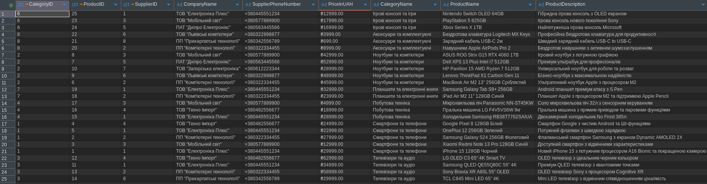
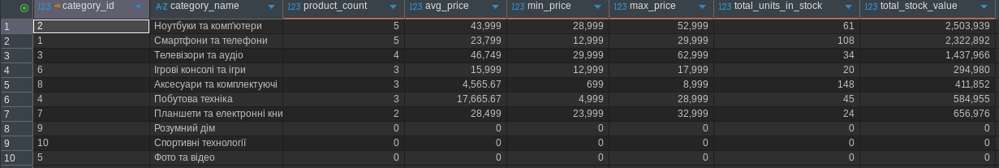
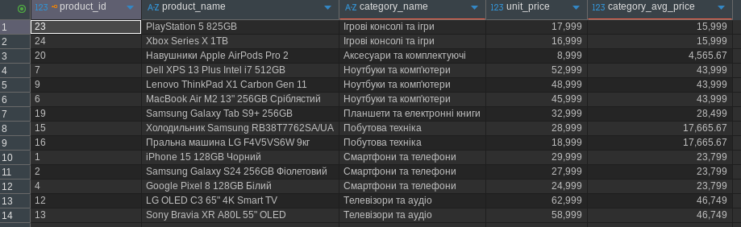
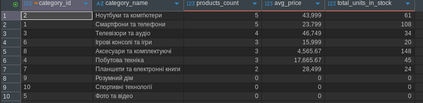
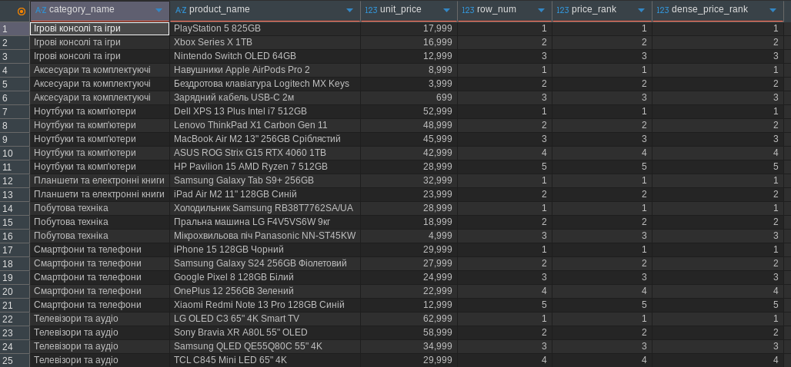
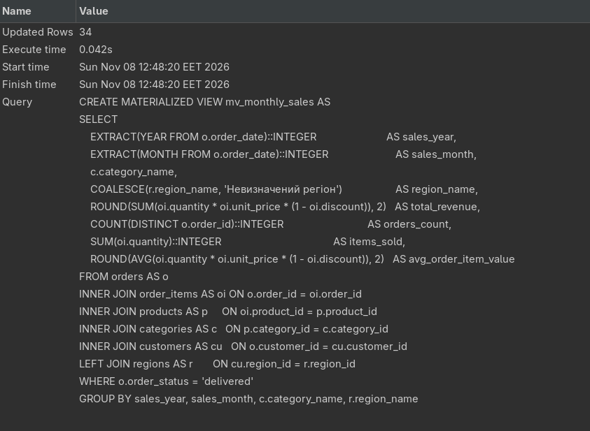
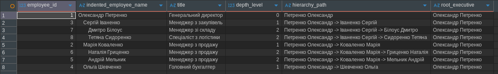
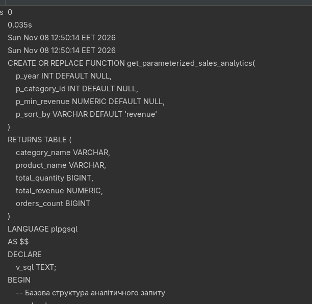

# Лабораторна робота 2. Створення складних SQL запитів

## Загальна інформація

**Здобувач освіти:** [Ваше ПІБ]  
**Група:** [Номер групи]  
**Обраний рівень складності:** [1 / 2 / 3]

## Виконання завдань

### Рівень 1

#### 1.1. INNER JOIN — товари з категоріями та постачальниками

```sql
-- Ваш запит тут
```

Результат: [опис результату]



#### 1.2. LEFT JOIN — усі клієнти, включно з тими, хто не робив замовлень

```sql
-- Ваш запит тут
```

Результат: [опис результату]



#### 1.3. Множинне з'єднання (4-5 таблиць)

```sql
-- Ваш запит тут
```

Результат: [опис результату]



#### 2.1. Кількість товарів та цінова статистика за категоріями

```sql
-- Ваш запит тут
```

Результат: [опис результату]



#### 2.2. Загальні продажі за регіонами (SUM, GROUP BY, HAVING)

```sql
-- Ваш запит тут
```

Результат: [опис результату]



#### 2.3. Постачальники з кількістю товарів більше 2

```sql
-- Ваш запит тут
```

Результат: [опис результату]


#### 3.1. Товари з ціною вищою за середню у своїй категорії

```sql
-- Ваш запит тут
```

Результат: [опис результату]



#### 3.2. Клієнти із замовленнями у 2024 році (підзапит IN)

```sql
-- Ваш запит тут
```

Результат: [опис результату]



#### 3.3. Товари із загальною кількістю продажів (підзапит у SELECT)

```sql
-- Ваш запит тут
```

Результат: [опис результату]



---

### Рівень 2

#### 4.1. RIGHT JOIN — аналіз категорій та наявності товарів

```sql
-- Ваш запит тут
```

Результат: [опис результату]


#### 4.2. Self-join — співробітники та їхні керівники

```sql
-- Ваш запит тут
```

Результат: [опис результату]


#### 4.3. FULL OUTER JOIN / умовне з'єднання

```sql
-- Ваш запит тут
```

Результат: [опис результату]


#### 5.1. Ранжування товарів за ціною в межах категорії

```sql
-- Ваш запит тут
```

Результат: [опис результату]


#### 5.2. Порівняння замовлень клієнта з попереднім (LAG / LEAD)

```sql
-- Ваш запит тут
```

Результат: [опис результату]


#### 5.3. Аналітика в розрізах з PARTITION BY

```sql
-- Ваш запит тут
```

Результат: [опис результату]


---

### Рівень 3

#### 6.1. Матеріалізоване представлення для аналізу продажів

```sql
-- Ваш запит тут
```

Результат: [опис результату]


#### 6.2. Рекурсивний CTE для ієрархії керівників

```sql
-- Ваш запит тут
```

Результат: [опис результату]


#### 6.3. Параметризована аналітика (динамічний SQL / процедура)

```sql
-- Ваш запит тут
```

Результат: [опис результату]


---

### Аналіз продуктивності

#### 7.1. Аналіз планів виконання (EXPLAIN ANALYZE)

```sql
-- Ваш запит тут
```

Результат: [аналіз плану виконання, вузькі місця]


#### 7.2. Оцінка складності та оптимізація запитів

| Запит | Оцінка складності | Спосіб оптимізації |
| :--- | :--- | :--- |
| [запит] | [Seq Scan / Index Scan, час] | [індекс, переписування, ...] |

#### 7.3. Створені індекси

```sql
-- Ваш запит тут
```

Результат: [опис впливу індексів на продуктивність]


---

## Висновки

[Опишіть, які навички було отримано: з'єднання таблиць, агрегатні функції, підзапити,
віконні функції, CTE, матеріалізовані представлення, оптимізація запитів.]

## Відповіді на контрольні запитання

1. **В чому різниця між INNER JOIN та LEFT JOIN?**
   [відповідь]

2. **Чому не можна використовувати WHERE для фільтрації результатів агрегатних функцій?**
   [відповідь]

3. **Як працюють корельовані підзапити?**
   [відповідь]

4. **Коли доцільно використовувати віконні функції замість GROUP BY?**
   [відповідь]

5. **Що таке матеріалізовані представлення та їхні переваги?**
   [відповідь]

6. **Як оптимізувати запити з множинними з'єднаннями?**
   [відповідь]

7. **Яка різниця між RANK() та DENSE_RANK()?**
   [відповідь]
