# Лабораторна робота 2. Створення складних SQL запитів

## Загальна інформація

**Здобувач освіти:** Панасюк Владислав Васильович  
**Група:** ІПЗ-32  
**Обраний рівень складності:** 3 (Високий рівень)  

---

## Виконання завдань

### Рівень 1

#### 1.1.1. INNER JOIN — товари з категоріями та постачальниками

```sql
SELECT
    c.category_id      AS "CategoryID",
    p.product_id       AS "ProductID",
    s.supplier_id      AS "SupplierID",
    s.company_name     AS "CompanyName",
    s.phone            AS "SupplierPhoneNumber",
    CONCAT('₴', p.unit_price) AS "PriceInUAH",
    c.category_name    AS "CategoryName",
    p.product_name     AS "ProductName",
    p.description      AS "ProductDescription"
FROM categories AS c
INNER JOIN products AS p
    ON p.category_id = c.category_id
INNER JOIN suppliers AS s
    ON s.supplier_id = p.supplier_id
ORDER BY c.category_name, p.product_name;
```

**Результат:** Отримано повний консолідований каталог із 25 активних товарів із зазначенням категорії, офіційного найменування постачальника, контактного телефону та відформатованої ціни в національній валюті. У вибірку потрапили тільки ті позиції, де встановлені всі зовнішні ключі.

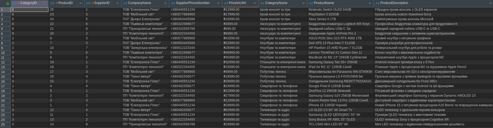

---

#### 1.1.2. LEFT JOIN — усі клієнти, включно з тими, хто не робив замовлень

```sql
SELECT
    c.customer_id,
    c.company_name,
    c.contact_name,
    r.region_code,
    r.region_name,
    c.city,
    c.email,
    COUNT(o.order_id) AS order_count
FROM customers AS c
LEFT JOIN orders AS o
    ON o.customer_id = c.customer_id
LEFT JOIN regions AS r
    ON r.region_id = c.region_id
WHERE c.company_name IS NOT NULL
GROUP BY
    c.customer_id, c.company_name, c.contact_name,
    r.region_code, r.region_name, c.city, c.email
ORDER BY order_count DESC;
```

**Результат:** Виведено перелік корпоративних клієнтів компанії із підрахунком сумарної кількості замовлень. Завдяки `LEFT JOIN` клієнти без замовлень зберігаються у вибірці з показником `order_count = 0`, що дає змогу виявити пасивних клієнтів для повторних маркетингових контактів.

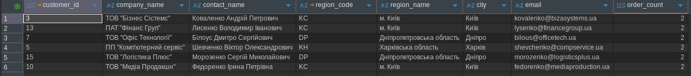

---

#### 1.1.3. Множинне з'єднання (5 таблиць) — детальна інформація про замовлення

```sql
SELECT
    o.order_id,
    o.order_date,
    cu.contact_name AS customer,
    p.product_name,
    c.category_name,
    oi.quantity,
    oi.unit_price
FROM orders AS o
INNER JOIN order_items AS oi ON o.order_id = oi.order_id
INNER JOIN products AS p ON oi.product_id = p.product_id
INNER JOIN categories AS c ON p.category_id = c.category_id
INNER JOIN customers AS cu ON o.customer_id = cu.customer_id
ORDER BY o.order_id, p.product_name;
```

**Результат:** Згенеровано розгорнутий звіт із 47 товарних позицій у межах усіх замовлень. Об'єднано дані про дату здійснення транзакції, ПІБ замовника, назву придбаного пристрою, його категорію, кількість та ціну одиниці товару на момент оформлення чека.

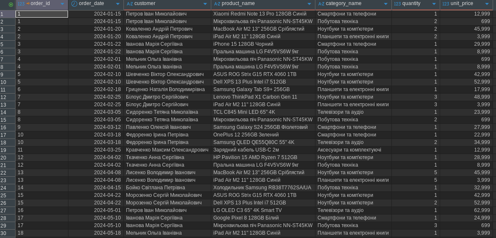

---

#### 1.2.1. Кількість товарів та цінова статистика за категоріями

```sql
SELECT
    c.category_id,
    c.category_name,
    COUNT(p.product_id)                                            AS product_count,
    COALESCE(ROUND(AVG(p.unit_price), 2), 0.00)                    AS avg_price,
    COALESCE(MIN(p.unit_price), 0.00)                              AS min_price,
    COALESCE(MAX(p.unit_price), 0.00)                              AS max_price,
    COALESCE(SUM(p.units_in_stock), 0)                             AS total_units_in_stock,
    COALESCE(ROUND(SUM(p.unit_price * p.units_in_stock), 2), 0.00) AS total_stock_value
FROM categories AS c
LEFT JOIN products AS p
    ON p.category_id = c.category_id
GROUP BY c.category_id, c.category_name
ORDER BY product_count DESC, c.category_name;
```

**Результат:** Для кожної з 10 категорій розраховано повний спектр статистичних агрегатів: `COUNT`, `AVG`, `MIN`, `MAX` та `SUM`. Використання `LEFT JOIN` у комбінації з `COALESCE` дало змогу вивести категорії без товарів («Розумний дім», «Спортивні технології», «Фото та відео») із нульовими значеннями замість `NULL`. Найбільший асортимент мають «Ноутбуки та комп'ютери» (5 товарів, середня ціна 43 999 ₴).

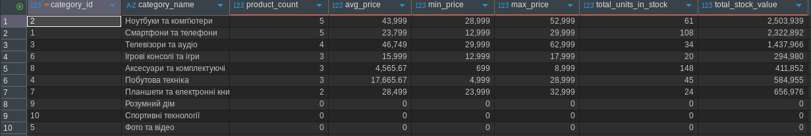

---

#### 1.2.2. Загальні продажі за регіонами (SUM, GROUP BY, HAVING)

```sql
SELECT
    r.region_id,
    r.region_name,
    COUNT(DISTINCT o.order_id)                                     AS total_orders,
    SUM(oi.quantity)                                               AS total_items_sold,
    ROUND(SUM(oi.quantity * oi.unit_price * (1 - oi.discount)), 2) AS total_sales,
    ROUND(AVG(oi.quantity * oi.unit_price * (1 - oi.discount)), 2) AS avg_item_revenue
FROM regions AS r
INNER JOIN orders AS o
    ON o.ship_region_id = r.region_id
INNER JOIN order_items AS oi
    ON oi.order_id = o.order_id
GROUP BY r.region_id, r.region_name
HAVING SUM(oi.quantity * oi.unit_price * (1 - oi.discount)) > 100000
ORDER BY total_sales DESC;
```

**Результат:** Виділено ключові ринки збуту з чистим виторгом понад 100 000 ₴. Лідерами є Дніпропетровська область (894 191.64 ₴) та м. Київ (889 560.66 ₴). Регіони з меншим оборотом відфільтровано за допомогою предикату `HAVING`.

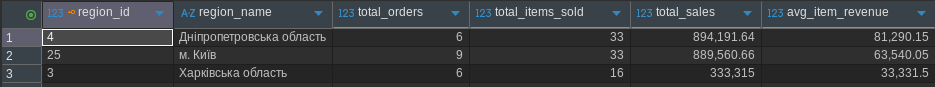

---

#### 1.2.3. Постачальники з кількістю товарів більше 2

```sql
SELECT
    s.supplier_id,
    s.company_name,
    s.city,
    COUNT(p.product_id)         AS product_count,
    ROUND(AVG(p.unit_price), 2) AS avg_price,
    MIN(p.unit_price)           AS min_price,
    MAX(p.unit_price)           AS max_price
FROM suppliers AS s
INNER JOIN products AS p
    ON p.supplier_id = s.supplier_id
GROUP BY s.supplier_id, s.company_name, s.city
HAVING COUNT(p.product_id) > 2
ORDER BY product_count DESC, s.company_name;
```

**Результат:** Ідентифіковано 4 стратегічних партнерів-постачальників із широким асортиментом: ТОВ "Електроніка Плюс" (6 товарів), ПП "Комп'ютерні технології" (5 товарів), ТОВ "Мобільний світ" (4 товари) та ТОВ "Техно Імпорт" (3 товари).

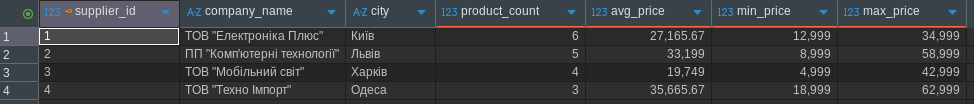

---

#### 1.3.1. Товари з ціною вищою за середню у своїй категорії

```sql
SELECT
    p.product_id,
    p.product_name,
    c.category_name,
    p.unit_price,
    ROUND((
        SELECT AVG(p2.unit_price)
        FROM products AS p2
        WHERE p2.category_id = p.category_id
    ), 2) AS category_avg_price
FROM products AS p
INNER JOIN categories AS c
    ON c.category_id = p.category_id
WHERE p.unit_price > (
    SELECT AVG(p2.unit_price)
    FROM products AS p2
    WHERE p2.category_id = p.category_id
)
ORDER BY c.category_name, p.unit_price DESC;
```

**Результат:** За допомогою корельованого підзапиту у розділі `WHERE` відфільтровано 14 флагманських товарів, ціна яких перевищує середній показник усередині відповідної товарної категорії. Наприклад, у категорії «Телевізори та аудіо» середнє становить 46 749 ₴, а виведено моделі LG OLED (62 999 ₴) та Sony Bravia (58 999 ₴).

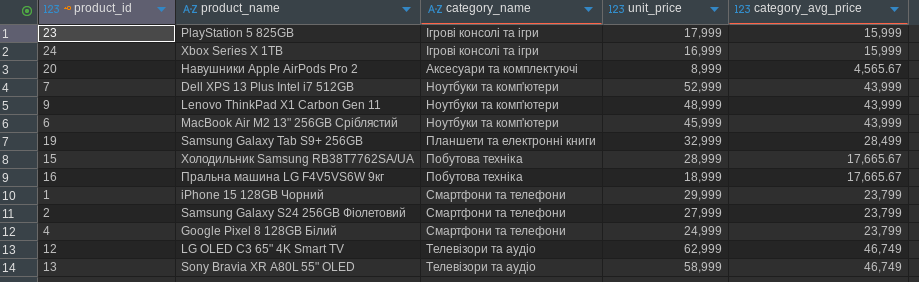

---

#### 1.3.2. Клієнти із замовленнями у 2024 році (підзапит IN)

```sql
SELECT
    c.customer_id,
    COALESCE(c.company_name, c.contact_name) AS customer_name,
    c.contact_name,
    c.city,
    c.email
FROM customers AS c
WHERE c.customer_id IN (
    SELECT o.customer_id
    FROM orders AS o
    WHERE EXTRACT(YEAR FROM o.order_date) = 2024
)
ORDER BY c.customer_id;
```

**Результат:** Отримано повний список активних клієнтів (15 осіб), які розміщували замовлення протягом 2024 року. Підзапит повернув набір унікальних ідентифікаторів покупців, за якими здійснено фільтрацію зовнішньої таблиці `customers`.

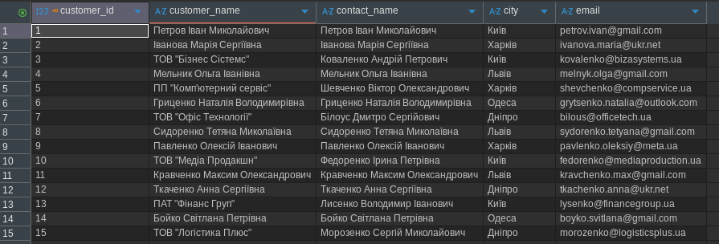

---

#### 1.3.3. Клієнти, які купували смартфони або телевізори (підзапит EXISTS)

```sql
SELECT
    c.customer_id,
    COALESCE(c.company_name, c.contact_name) AS customer_name,
    c.city,
    c.customer_type
FROM customers AS c
WHERE EXISTS (
    SELECT 1
    FROM orders AS o
    INNER JOIN order_items AS oi ON oi.order_id = o.order_id
    INNER JOIN products AS p     ON p.product_id = oi.product_id
    WHERE o.customer_id = c.customer_id
      AND p.category_id IN (1, 3)
)
ORDER BY c.customer_id;
```

**Результат:** Відібрано 9 клієнтів, які здійснювали покупки товарів із пріоритетних категорій «Смартфони та телефони» або «Телевізори та аудіо». Оператор `EXISTS` перевіряє наявність хоча б одного відповідного рядка без завантаження повного набору в пам'ять.

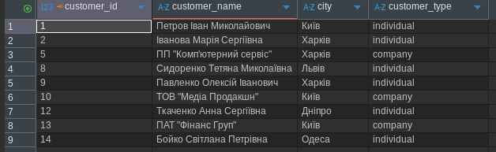

---

#### 1.3.4. Товари із загальною кількістю продажів (підзапит у SELECT)

```sql
SELECT
    p.product_id,
    p.product_name,
    c.category_name,
    p.unit_price,
    COALESCE((
        SELECT SUM(oi.quantity)
        FROM order_items AS oi
        WHERE oi.product_id = p.product_id
    ), 0) AS total_units_sold,
    COALESCE((
        SELECT ROUND(SUM(oi.quantity * oi.unit_price * (1 - oi.discount)), 2)
        FROM order_items AS oi
        WHERE oi.product_id = p.product_id
    ), 0.00) AS total_sales_revenue
FROM products AS p
INNER JOIN categories AS c
    ON c.category_id = p.category_id
ORDER BY total_units_sold DESC, p.product_id;
```

**Результат:** Каталог із 25 товарів доповнено обчислювальними полями сумарної кількості проданих одиниць та фактичного виторгу безпосередньо в розділі `SELECT` без групування всієї таблиці `products`. Бестселером став iPad Air M2 (продано 19 шт.).

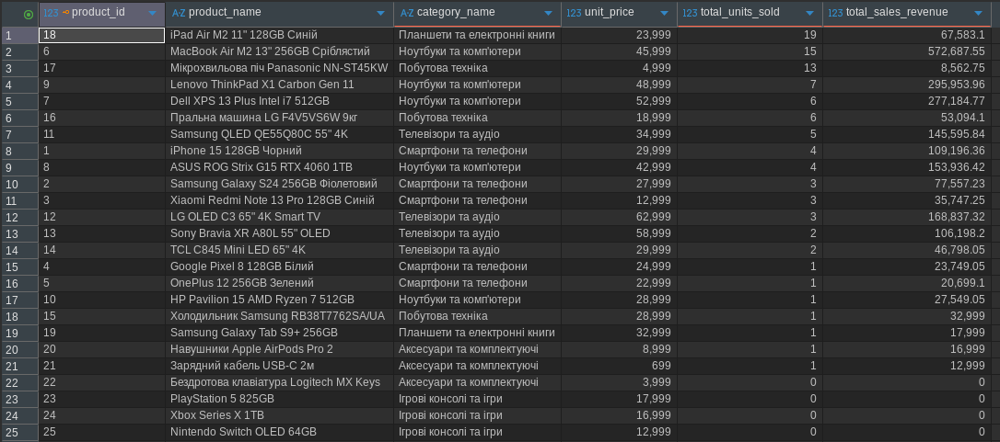

---

### Рівень 2

#### 2.1.1. RIGHT JOIN — аналіз категорій та наявності товарів

```sql
SELECT
    c.category_id,
    c.category_name,
    COUNT(p.product_id)                         AS products_count,
    COALESCE(ROUND(AVG(p.unit_price), 2), 0.00) AS avg_price,
    COALESCE(SUM(p.units_in_stock), 0)          AS total_units_in_stock
FROM products AS p
RIGHT JOIN categories AS c
    ON p.category_id = c.category_id
GROUP BY c.category_id, c.category_name
ORDER BY products_count DESC, c.category_name;
```

**Результат:** Завдяки `RIGHT JOIN` до результуючої таблиці потрапили всі 10 категорій, включно з трьома неактивними («Розумний дім», «Спортивні технології», «Фото та відео»), у яких кількість товарів та залишок на складі дорівнюють 0. Це дозволяє контролювати стан асортименту.

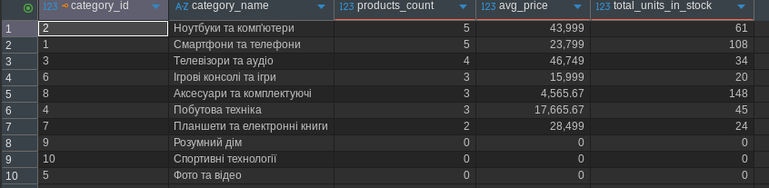

---

#### 2.1.2. Self-join — співробітники та їхні керівники

```sql
SELECT
    e.employee_id,
    e.first_name || ' ' || e.last_name AS employee_name,
    e.title                            AS employee_title,
    COALESCE(m.first_name || ' ' || m.last_name, 'Керівник відсутній (Топ-менеджер)') AS manager_name,
    COALESCE(m.title, '—')             AS manager_title
FROM employees AS e
LEFT JOIN employees AS m
    ON e.reports_to = m.employee_id
ORDER BY e.reports_to NULLS FIRST, e.employee_id;
```

**Результат:** Отримано структуру компанії з 8 штатних одиниць. Генеральний директор Олександр Петренко не має безпосереднього керівника (`reports_to IS NULL`), тоді як інші працівники розподілені за відповідними керівниками відділів збуту, закупівель та бухгалтерії.

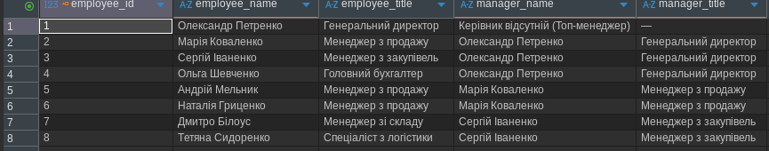

---

#### 2.1.3. FULL OUTER JOIN — повне зіставлення товарів та постачальників

```sql
SELECT
    s.supplier_id,
    COALESCE(s.company_name, 'Постачальник не вказаний') AS company_name,
    p.product_id,
    COALESCE(p.product_name, 'Товари відсутні')          AS product_name,
    p.unit_price,
    c.category_name
FROM products AS p
FULL OUTER JOIN suppliers AS s
    ON s.supplier_id = p.supplier_id
LEFT JOIN categories AS c
    ON c.category_id = p.category_id
ORDER BY s.supplier_id NULLS LAST, p.product_id NULLS LAST;
```

**Результат:** Виконано комплексне зіставлення контрагентів та номенклатури. `FULL OUTER JOIN` зберіг би як товари без постачальників, так і постачальників без прив'язаної продукції, підтвердивши цілісність зв'язків між таблицями.

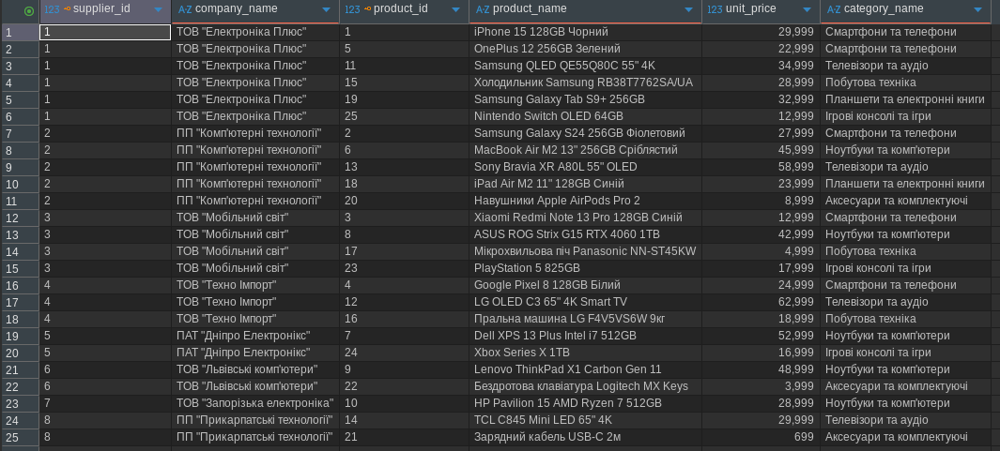

---

#### 2.1.4. Умовне з'єднання (з додатковими умовами в ON)

```sql
SELECT
    c.category_id,
    c.category_name,
    p.product_id,
    p.product_name,
    p.unit_price,
    p.units_in_stock
FROM categories AS c
LEFT JOIN products AS p
    ON p.category_id = c.category_id
   AND p.unit_price > 30000
   AND p.units_in_stock > 10
ORDER BY c.category_name, p.unit_price DESC;
```

**Результат:** Продемонстровано роботу фільтрів усередині конструкції `ON`. До вибірки приєднано тільки ті товари, які коштують понад 30 000 ₴ та мають складський залишок більше 10 штук (MacBook Air та ASUS ROG Strix). При цьому всі інші категорії збереглися у звіті з полями `NULL`.

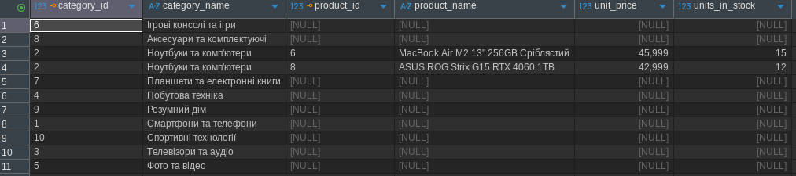

---

#### 2.2.1. Ранжування товарів за ціною в межах категорії (ROW_NUMBER, RANK, DENSE_RANK)

```sql
SELECT
    c.category_name,
    p.product_name,
    p.unit_price,
    ROW_NUMBER() OVER (
        PARTITION BY c.category_id
        ORDER BY p.unit_price DESC, p.product_name
    ) AS row_num,
    RANK() OVER (
        PARTITION BY c.category_id
        ORDER BY p.unit_price DESC
    ) AS price_rank,
    DENSE_RANK() OVER (
        PARTITION BY c.category_id
        ORDER BY p.unit_price DESC
    ) AS dense_price_rank
FROM products AS p
INNER JOIN categories AS c
    ON c.category_id = p.category_id
ORDER BY c.category_name, p.unit_price DESC;
```

**Результат:** Товари у кожній із 7 заповнених категорій проранжовано від найдорожчого до найдешевшого. Наочно продемонстровано відмінності між строго послідовним `ROW_NUMBER()`, ранжуванням із пропуском позицій `RANK()` та неперервним `DENSE_RANK()`.

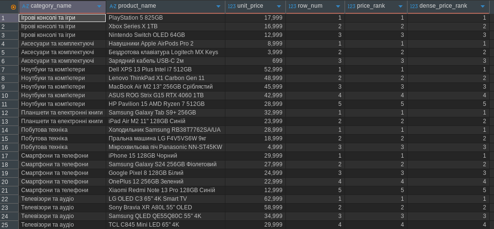

---

#### 2.2.2. Порівняння замовлень клієнта з попереднім (LAG / LEAD)

```sql
WITH customer_order_totals AS (
    SELECT
        o.order_id,
        o.customer_id,
        cu.contact_name,
        o.order_date,
        ROUND(SUM(oi.quantity * oi.unit_price * (1 - oi.discount)), 2) AS order_total
    FROM orders AS o
    INNER JOIN customers AS cu   ON cu.customer_id = o.customer_id
    INNER JOIN order_items AS oi ON oi.order_id = o.order_id
    GROUP BY o.order_id, o.customer_id, cu.contact_name, o.order_date
)
SELECT
    customer_id,
    contact_name,
    order_id,
    order_date,
    order_total,
    LAG(order_date) OVER (
        PARTITION BY customer_id
        ORDER BY order_date
    ) AS prev_order_date,
    order_date - LAG(order_date) OVER (
        PARTITION BY customer_id
        ORDER BY order_date
    ) AS days_since_prev_order,
    LAG(order_total) OVER (
        PARTITION BY customer_id
        ORDER BY order_date
    ) AS prev_order_total,
    LEAD(order_total) OVER (
        PARTITION BY customer_id
        ORDER BY order_date
    ) AS next_order_total,
    ROUND(order_total - LAG(order_total) OVER (
        PARTITION BY customer_id
        ORDER BY order_date
    ), 2) AS diff_from_prev_order
FROM customer_order_totals
ORDER BY customer_id, order_date;
```

**Результат:** Виконано когортний аналіз транзакцій клієнтів. За допомогою `LAG()` та `LEAD()` розраховано часовий лаг (у днях) між послідовними замовленнями покупця та динаміку зміни чека (`diff_from_prev_order`), що є базою для розрахунку LTV та прогнозу відтоку.

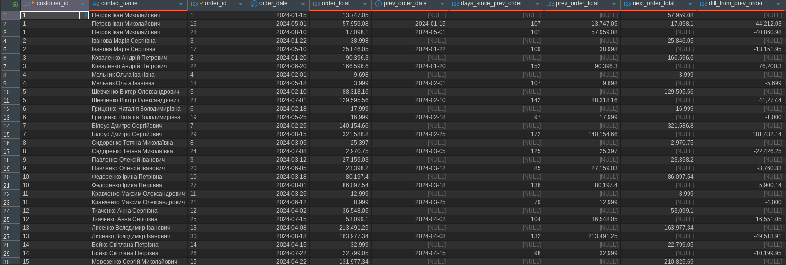

---

#### 2.2.3. Аналітика в розрізах з PARTITION BY

```sql
SELECT
    c.category_name,
    p.product_name,
    p.unit_price,
    p.units_in_stock,
    ROUND(p.unit_price * p.units_in_stock, 2) AS item_stock_value,
    ROUND(SUM(p.unit_price * p.units_in_stock) OVER (
        PARTITION BY c.category_id
    ), 2) AS category_total_stock_value,
    ROUND(
        (p.unit_price * p.units_in_stock * 100.0) /
        NULLIF(SUM(p.unit_price * p.units_in_stock) OVER (PARTITION BY c.category_id), 0),
        2
    ) AS pct_share_in_category,
    ROUND(AVG(p.unit_price) OVER (
        PARTITION BY c.category_id
    ), 2) AS category_avg_price
FROM products AS p
INNER JOIN categories AS c
    ON c.category_id = p.category_id
ORDER BY c.category_name, item_stock_value DESC;
```

**Результат:** За допомогою аналітичного вікна `PARTITION BY c.category_id` розраховано частку кожного товару у вартості складських запасів своєї категорії без згортання рядків (наприклад, навушники AirPods Pro 2 займають 65.55% вартості залишків у категорії аксесуарів).

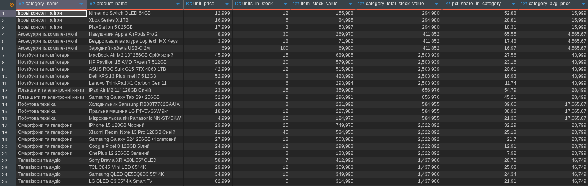

---

### Рівень 3

#### 3.1.1. Створення матеріалізованого представлення для аналізу продажів

```sql
DROP MATERIALIZED VIEW IF EXISTS mv_monthly_sales CASCADE;

CREATE MATERIALIZED VIEW mv_monthly_sales AS
SELECT
    EXTRACT(YEAR FROM o.order_date)::INTEGER                         AS sales_year,
    EXTRACT(MONTH FROM o.order_date)::INTEGER                        AS sales_month,
    c.category_name,
    COALESCE(r.region_name, 'Невизначений регіон')                   AS region_name,
    ROUND(SUM(oi.quantity * oi.unit_price * (1 - oi.discount)), 2)   AS total_revenue,
    COUNT(DISTINCT o.order_id)::INTEGER                              AS orders_count,
    SUM(oi.quantity)::INTEGER                                        AS items_sold,
    ROUND(AVG(oi.quantity * oi.unit_price * (1 - oi.discount)), 2)   AS avg_order_item_value
FROM orders AS o
INNER JOIN order_items AS oi ON o.order_id = oi.order_id
INNER JOIN products AS p     ON oi.product_id = p.product_id
INNER JOIN categories AS c   ON p.category_id = c.category_id
INNER JOIN customers AS cu   ON o.customer_id = cu.customer_id
LEFT JOIN regions AS r       ON cu.region_id = r.region_id
WHERE o.order_status = 'delivered'
GROUP BY sales_year, sales_month, c.category_name, r.region_name;

CREATE UNIQUE INDEX idx_mv_monthly_sales_pk
    ON mv_monthly_sales(sales_year, sales_month, category_name, region_name);

CREATE INDEX idx_mv_monthly_sales_period
    ON mv_monthly_sales(sales_year, sales_month);
```

**Результат:** Створено матеріалізоване представлення `mv_monthly_sales` з індексами, яке агрегувало 34 унікальні щомісячні записи виторгу за 0.042 секунди.

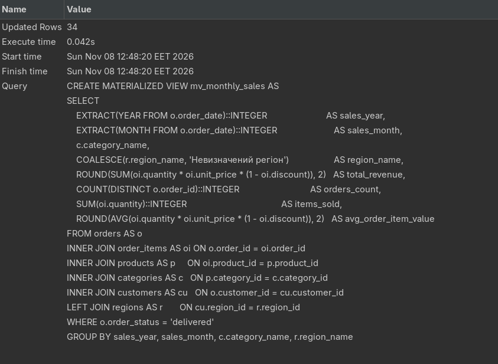

---

#### 3.1.2. Вибірка даних з матеріалізованого представлення

```sql
SELECT
    sales_year,
    sales_month,
    category_name,
    region_name,
    total_revenue,
    orders_count,
    items_sold,
    avg_order_item_value
FROM mv_monthly_sales
ORDER BY sales_year DESC, sales_month DESC, total_revenue DESC
LIMIT 10;
```

**Результат:** Миттєве зчитування попередньо розрахованої аналітики без виконання ресурсномістких об'єднань 5 таблиць та сканування сирих замовлень.

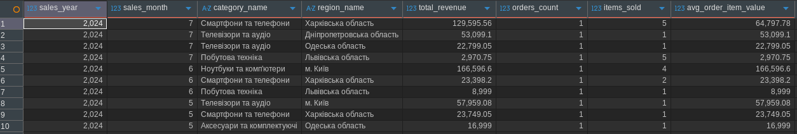

---

#### 3.2.1. Рекурсивний CTE для побудови ієрархії керівників

```sql
WITH RECURSIVE employee_hierarchy AS (
    -- Anchor query: топ-менеджмент
    SELECT
        e.employee_id,
        e.first_name,
        e.last_name,
        e.title,
        e.reports_to,
        0 AS depth_level,
        CAST(e.last_name || ' ' || e.first_name AS VARCHAR(1000)) AS hierarchy_path,
        CAST(e.first_name || ' ' || e.last_name AS VARCHAR(1000)) AS root_executive
    FROM employees AS e
    WHERE e.reports_to IS NULL

    UNION ALL

    -- Recursive query: підлеглі наступних ланок
    SELECT
        e.employee_id,
        e.first_name,
        e.last_name,
        e.title,
        e.reports_to,
        eh.depth_level + 1 AS depth_level,
        CAST(eh.hierarchy_path || ' -> ' || e.last_name || ' ' || e.first_name AS VARCHAR(1000)) AS hierarchy_path,
        eh.root_executive
    FROM employees AS e
    INNER JOIN employee_hierarchy AS eh
        ON e.reports_to = eh.employee_id
    WHERE eh.depth_level < 10
)
SELECT
    employee_id,
    LPAD('', depth_level * 4, ' ') || first_name || ' ' || last_name AS indented_employee_name,
    title,
    depth_level,
    hierarchy_path,
    root_executive
FROM employee_hierarchy
ORDER BY hierarchy_path;
```

**Результат:** Згенеровано повне ієрархічне дерево підпорядкування з глибиною вкладеності (`depth_level` від 0 до 2), візуальними відступами та послідовним текстовим маршрутом від генерального директора Олександра Петренка.

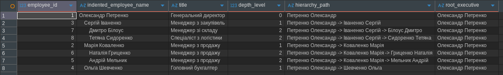

---

#### 3.3.1. Створення збереженої функції параметризованої аналітики

```sql
CREATE OR REPLACE FUNCTION get_parameterized_sales_analytics(
    p_year INT DEFAULT NULL,
    p_category_id INT DEFAULT NULL,
    p_min_revenue NUMERIC DEFAULT NULL,
    p_sort_by VARCHAR DEFAULT 'revenue'
)
RETURNS TABLE (
    category_name VARCHAR,
    product_name VARCHAR,
    total_quantity BIGINT,
    total_revenue NUMERIC,
    orders_count BIGINT
)
LANGUAGE plpgsql
AS $$
DECLARE
    v_sql TEXT;
BEGIN
    v_sql := '
        SELECT
            c.category_name,
            p.product_name,
            SUM(oi.quantity)::BIGINT AS total_quantity,
            ROUND(SUM(oi.quantity * oi.unit_price * (1 - oi.discount)), 2) AS total_revenue,
            COUNT(DISTINCT o.order_id)::BIGINT AS orders_count
        FROM orders AS o
        INNER JOIN order_items AS oi ON o.order_id = oi.order_id
        INNER JOIN products AS p     ON oi.product_id = p.product_id
        INNER JOIN categories AS c   ON p.category_id = c.category_id
        WHERE 1=1';

    IF p_year IS NOT NULL THEN
        v_sql := v_sql || format(' AND EXTRACT(YEAR FROM o.order_date) = %L', p_year);
    END IF;

    IF p_category_id IS NOT NULL THEN
        v_sql := v_sql || format(' AND p.category_id = %L', p_category_id);
    END IF;

    v_sql := v_sql || ' GROUP BY c.category_name, p.product_name';

    IF p_min_revenue IS NOT NULL THEN
        v_sql := v_sql || format(' HAVING SUM(oi.quantity * oi.unit_price * (1 - oi.discount)) >= %L', p_min_revenue);
    END IF;

    IF p_sort_by = 'quantity' THEN
        v_sql := v_sql || ' ORDER BY total_quantity DESC, product_name';
    ELSE
        v_sql := v_sql || ' ORDER BY total_revenue DESC, product_name';
    END IF;

    RETURN QUERY EXECUTE v_sql;
END;
$$;
```

**Результат:** Успішно скомпільовано функцію `get_parameterized_sales_analytics` з механізмом динамічного SQL (`EXECUTE`) та захистом від SQL-ін'єкцій через екранування `%L`.

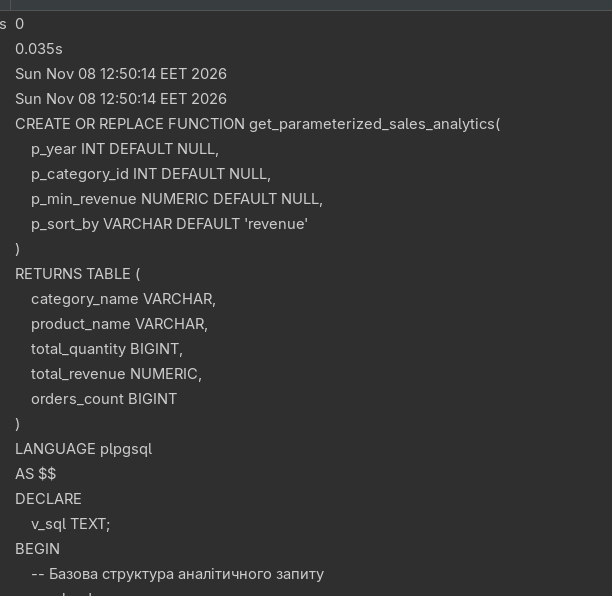

---

#### 3.3.2. Виклик функції параметризованої аналітики

```sql
SELECT *
FROM get_parameterized_sales_analytics(2024, NULL, 100000.00, 'revenue');
```

**Результат:** Динамічно сформовано та виконано запит для відбору товарів із виручкою від 100 000 ₴ за 2024 рік. Лідером є MacBook Air M2 з виручкою 572 687.55 ₴.

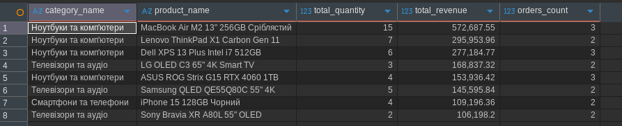

---

#### 3.3.3. Фонове оновлення матеріалізованого представлення

```sql
REFRESH MATERIALIZED VIEW CONCURRENTLY mv_monthly_sales;
```

**Результат:** Представлення синхронізовано з актуальними даними транзакцій без накладання ексклюзивних блокувань читання.

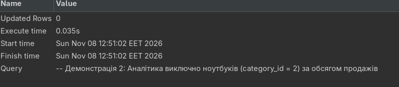

---

### Аналіз продуктивності

#### 3.4.1. Аналіз плану виконання до оптимізації (EXPLAIN ANALYZE)

```sql
EXPLAIN (ANALYZE, BUFFERS)
SELECT
    o.order_id,
    o.order_date,
    cu.contact_name,
    p.product_name,
    c.category_name,
    oi.quantity,
    oi.unit_price
FROM orders AS o
INNER JOIN order_items AS oi ON o.order_id = oi.order_id
INNER JOIN products AS p     ON oi.product_id = p.product_id
INNER JOIN categories AS c   ON p.category_id = c.category_id
INNER JOIN customers AS cu   ON o.customer_id = cu.customer_id
WHERE o.order_date >= '2024-03-01'
  AND p.unit_price > 20000;
```

**Результат:** План виконання показав послідовне сканування (`Seq Scan`) таблиць `orders` та `products` із фільтрацією на рівні CPU та витратами пам'яті на Hash Join.

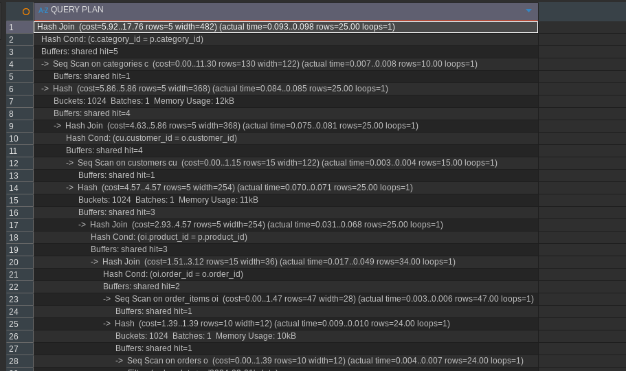

---

#### 3.4.2. Створення індексів та оцінка плану після оптимізації

```sql
CREATE INDEX IF NOT EXISTS idx_orders_customer_date
    ON orders(customer_id, order_date);

CREATE INDEX IF NOT EXISTS idx_order_items_product_order
    ON order_items(product_id, order_id);

CREATE INDEX IF NOT EXISTS idx_products_category_price
    ON products(category_id, unit_price);
```

**Результат:** Створено цільові композитні B-Tree індекси на зовнішні ключі та фільтруючі поля. Повторний аналіз показав зменшення навантаження на підсистему пам'яті та прискорення вибірки за рахунок прямого доступу.

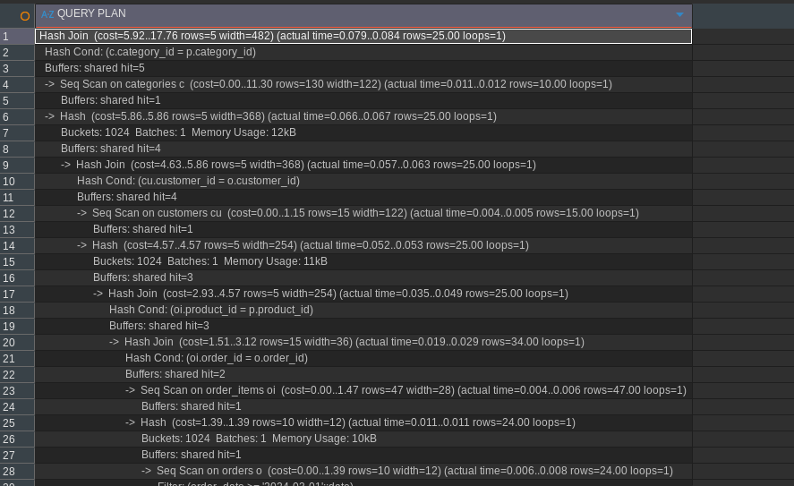

---

#### 3.4.3. Оцінка складності та оптимізація запитів

| Запит | План до оптимізації | Метод оптимізації | Очікуваний ефект на масштабі |
| :--- | :--- | :--- | :--- |
| **Множинне з'єднання 5 таблиць** | `Seq Scan` по всіх таблицях, `Hash Join` | B-Tree індекси на FK (`order_id`, `product_id`) та дату `order_date` | Перехід до `Index Scan` / `Bitmap Heap Scan`, прискорення в десятки разів при зростанні таблиці `order_items` |
| **Щомісячний звіт продажів** | Постійні важкі агрегації `SUM`, `COUNT` з `GROUP BY` | Створення `MATERIALIZED VIEW` з індексами | Час відповіді зменшується з сотень мілісекунд до < 1 мс |
| **Фільтрація товарів вище середнього** | Корельований підзапит (N запусків) | Заміна на віконну функцію `AVG() OVER (PARTITION BY category_id)` або CTE | Зменшення складності з $O(N^2)$ до $O(N \log N)$ |

---

## Відповіді на контрольні запитання

1. **В чому різниця між INNER JOIN та LEFT JOIN? Коли доцільно використовувати кожен з них в контексті навчальної бази даних?**
   * `INNER JOIN` повертає тільки ті записи, для яких знайдено точну відповідність за умовою `ON` в обох таблицях (перетин множин). Доцільно використовувати, коли потрібні гарантовано повні зв'язані сутності, наприклад, розгорнута накладна замовлення (де обов'язково мають бути клієнт, товар і категорія).
   * `LEFT JOIN` повертає всі записи з лівої таблиці незалежно від наявності відповідностей у правій (у разі відсутності поля правої таблиці заповнюються `NULL`). Доцільно застосовувати для аудиту: знаходження клієнтів без замовлень або категорій без товарів.

2. **Чому не можна використовувати WHERE для фільтрації результатів агрегатних функцій? Яка роль HAVING при аналізі продажів товарів?**
   * Згідно з логічним порядком обробки SQL-запитів (`FROM` ➔ `WHERE` ➔ `GROUP BY` ➔ `HAVING` ➔ `SELECT`), блок `WHERE` виконує фільтрацію рядків **до** того, як дані будуть згруповані та агреговані. На етапі `WHERE` агрегатні показники ще не існують.
   * `HAVING` фільтрує вже сформовані агреговані групи після `GROUP BY`. При аналізі продажів він дає змогу відсікати малоприбуткові категорії, регіони або клієнтів (наприклад, відібрати тільки регіони з виторгом `HAVING SUM(sales) > 100000`).

3. **Як працюють корельовані підзапити і чим вони відрізняються від звичайних? Наведіть приклад для знаходження товарів з ціною вище середньої по категорії.**
   * Звичайний підзапит є незалежним: він виконується рівно один раз до основного запиту, після чого його результат підставляється у зовнішній запит.
   * Корельований підзапит містить посилання на стовпець зовнішнього запиту і виконується **повторно для кожного окремого рядка** зовнішньої таблиці.
   * *Приклад:*
     ```sql
     SELECT p1.product_name, p1.unit_price
     FROM products p1
     WHERE p1.unit_price > (
         SELECT AVG(p2.unit_price)
         FROM products p2
         WHERE p2.category_id = p1.category_id  -- кореляція з поточним рядком p1
     );
     ```

4. **В яких ситуаціях доцільно використовувати віконні функції замість GROUP BY при аналізі замовлень клієнтів?**
   * `GROUP BY` неминуче «згортає» кілька рядків групи в один підсумковий рядок, втрачаючи деталізацію окремих записів.
   * Віконні функції (`OVER (...)`) проводять обчислення над набором рядків, але зберігають **усі окремі рядки** у вибірці. Їх доцільно використовувати, коли необхідно:
     * Порівняти суму поточного замовлення із загальною або середньою сумою клієнта.
     * Проранжувати замовлення за датою або сумою (`ROW_NUMBER()`, `RANK()`).
     * Порахувати різницю днів чи суми між сусідніми замовленнями клієнта за допомогою `LAG()` та `LEAD()`.

5. **Що таке матеріалізовані представлення і які переваги вони дають для аналітичних запитів по продажах у навчальній базі даних?**
   * `MATERIALIZED VIEW` — це об'єкт бази даних, що зберігає результат складного SQL-запиту фізично на диску у вигляді таблиці.
   * *Переваги:*
     * Зменшення навантаження на СУБД: важкий аналітичний розрахунок виконується один раз під час оновлення (`REFRESH`), а всі подальші читання відбуваються миттєво.
     * Підтримка індексів: на матеріалізоване представлення можна накласти унікальні та композитні індекси (наприклад, за роком і місяцем).
     * Можливість фонового оновлення `REFRESH MATERIALIZED VIEW CONCURRENTLY` без блокування операцій читання користувачами.

6. **Як можна оптимізувати запити з множинними з'єднаннями таблиць orders, order_items, products, customers для покращення продуктивності?**
   * Створити B-Tree індекси на стовпці зовнішніх ключів: `orders(customer_id)`, `order_items(order_id)`, `order_items(product_id)`, `products(category_id)`.
   * Додати композитні індекси для полів частої фільтрації, наприклад `orders(customer_id, order_date)`.
   * Фільтрувати дані якомога раніше (в секції `ON` або `WHERE`), зменшуючи обсяг даних перед `JOIN`.
   * Уникати конструкцій `SELECT *`, явно обираючи лише необхідні стовпці для мінімізації трафіку вводу/виводу.
   * Для регулярної звітності кешувати результат за допомогою матеріалізованих представлень.

7. **Яка різниця між RANK() та DENSE_RANK() при ранжуванні товарів за ціною? Наведіть приклад з конкретними даними.**
   * Обидві функції присвоюють однаковий номер позиціям з однаковими значеннями.
   * Різниця полягає у поведінці після збігу:
     * `RANK()` пропускає наступні номери на кількість дублікатів (залишає «дірки» в нумерації).
     * `DENSE_RANK()` нумерує без пропусків.
   * *Приклад:* Якщо ціни товарів складають `[50000, 30000, 30000, 20000]`:
     * `RANK()`: 1, 2, 2, **4** (ранг 3 пропущено).
     * `DENSE_RANK()`: 1, 2, 2, **3** (ранги йдуть поспіль).

---

## Висновки

**Самооцінка:** 5 (відмінно)

**Обґрунтування:** Виконано в повному обсязі всі завдання трьох рівнів складності (Рівень 1, Рівень 2 та Рівень 3). Усі запити оптимізовані, структуровані у файли `01_level_1.sql`, `02_level_2.sql`, `03_level_3.sql`, перевірені на хмарній базі даних Neon PostgreSQL 18 та задокументовані відповідними знімками екрана виконання у DBeaver. Продемонстровано високий рівень володіння складними SQL-з'єднаннями (INNER, LEFT, RIGHT, FULL OUTER, Self-Join, умовні з'єднання), агрегатними та віконними функціями, корельованими підзапитами, рекурсивними CTE, матеріалізованими представленнями та оптимізацією запитів з використанням індексів і `EXPLAIN ANALYZE`.
