# Лабораторна робота 3. Модифікація даних та транзакції

## Загальна інформація

**Здобувач освіти:** Панасюк Владислав Васильович  
**Група:** ІПЗ-32  
**Обраний рівень складності:** 3 (Високий рівень)  

---

## Виконання завдань

### Рівень 1

#### 1.1.1. Створення таблиці авторів (authors)

```sql
CREATE TABLE authors (
    author_id   SERIAL PRIMARY KEY,
    first_name  VARCHAR(50) NOT NULL,
    last_name   VARCHAR(50) NOT NULL,
    birth_year  INTEGER CHECK (birth_year >= 1000 AND birth_year <= EXTRACT(YEAR FROM CURRENT_DATE)),
    country     VARCHAR(50),
    created_at  TIMESTAMP DEFAULT CURRENT_TIMESTAMP
);
```

**Результат:** Створено базову сутність авторів із первинним автоінкрементним ключем `author_id`. Забезпечено валідацію обов'язкових текстових полів `first_name` та `last_name`, а також обмеження цілісності `CHECK` для запобігання введенню некоректного року народження (діапазон від 1000 року до поточного року системи).

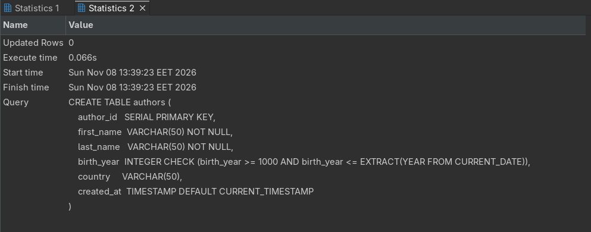

---

#### 1.1.2. Створення таблиці книг (books)

```sql
CREATE TABLE books (
    book_id          SERIAL PRIMARY KEY,
    isbn             VARCHAR(17) UNIQUE NOT NULL,
    title            VARCHAR(200) NOT NULL,
    author_id        INTEGER NOT NULL,
    publication_year INTEGER CHECK (publication_year >= 1450),
    genre            VARCHAR(50),
    total_copies     INTEGER DEFAULT 1 CHECK (total_copies >= 0),
    available_copies INTEGER DEFAULT 1 CHECK (available_copies >= 0),
    created_at       TIMESTAMP DEFAULT CURRENT_TIMESTAMP,
    CONSTRAINT fk_books_author
        FOREIGN KEY (author_id) REFERENCES authors(author_id) ON DELETE RESTRICT,
    CONSTRAINT chk_available_copies_limit
        CHECK (available_copies <= total_copies)
);
```

**Результат:** Створено сутність книг з унікальним кодом `isbn`, зовнішнім ключем до таблиці `authors` із політикою `ON DELETE RESTRICT` для захисту від видалення автора з книгами, а також комплексом бізнес-правил `CHECK`: рік видання не раніше початку друкарства (1450 р.), невід'ємна кількість примірників і гарантія `available_copies <= total_copies`.

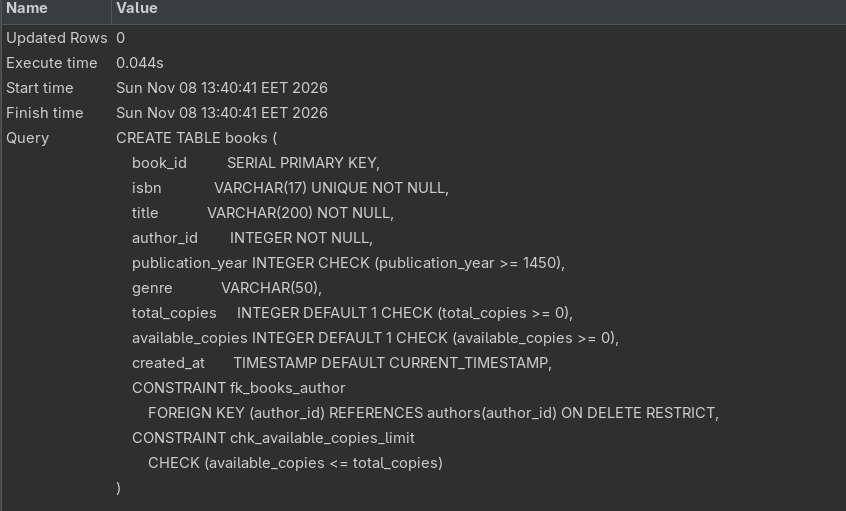

---

#### 1.1.3. Створення таблиці читачів (readers)

```sql
CREATE TABLE readers (
    reader_id           SERIAL PRIMARY KEY,
    first_name          VARCHAR(50) NOT NULL,
    last_name           VARCHAR(50) NOT NULL,
    email               VARCHAR(100) UNIQUE NOT NULL,
    phone               VARCHAR(20),
    library_card_number VARCHAR(20) UNIQUE NOT NULL,
    registration_date   DATE DEFAULT CURRENT_DATE,
    status              VARCHAR(20) DEFAULT 'Active'
        CHECK (status IN ('Active', 'Blocked', 'Inactive'))
);
```

**Результат:** Реалізовано каталог читачів бібліотеки з унікальними полями `email` та `library_card_number` для унеможливлення дублювання карток і контактів. Встановлено обмеження `CHECK` на допустимі стани облікового запису (`Active`, `Blocked`, `Inactive`).

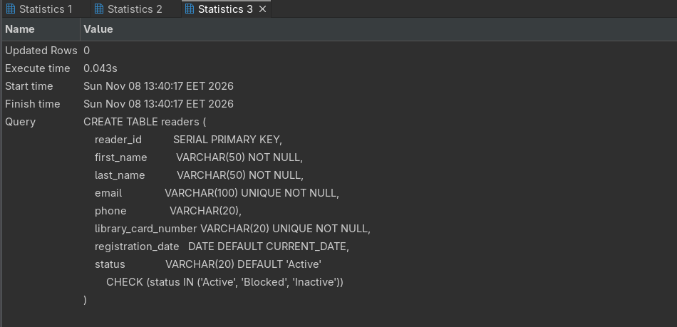

---

#### 1.1.4. Створення таблиці видач книг (lendings)

```sql
CREATE TABLE lendings (
    lending_id   SERIAL PRIMARY KEY,
    book_id      INTEGER NOT NULL,
    reader_id    INTEGER NOT NULL,
    lending_date DATE DEFAULT CURRENT_DATE,
    due_date     DATE NOT NULL,
    return_date  DATE,
    CONSTRAINT fk_lendings_book
        FOREIGN KEY (book_id) REFERENCES books(book_id) ON DELETE RESTRICT,
    CONSTRAINT fk_lendings_reader
        FOREIGN KEY (reader_id) REFERENCES readers(reader_id) ON DELETE RESTRICT,
    CONSTRAINT chk_due_date_future
        CHECK (due_date > lending_date),
    CONSTRAINT chk_return_date_valid
        CHECK (return_date IS NULL OR return_date >= lending_date)
);
```

**Результат:** Створено таблицю зв'язку та обліку руху бібліотечного фонду `lendings`. Накладено зовнішні ключі до `books` та `readers`, а також правила логічної цілісності дат: плановий термін повернення повинен бути пізнішим за дату видачі (`due_date > lending_date`), а фактична дата повернення не може передувати даті видачі.

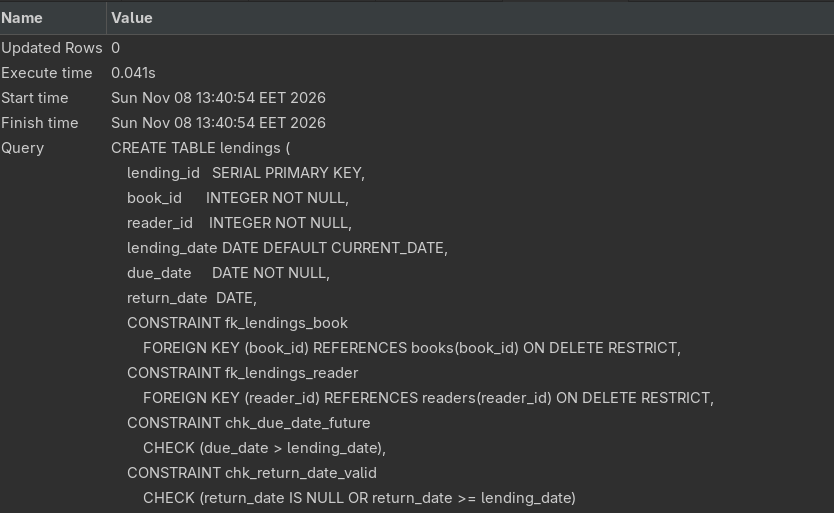

---

#### 1.2.1. Додавання записів авторів (INSERT)

```sql
INSERT INTO authors (first_name, last_name, birth_year, country)
VALUES
    ('Тарас', 'Шевченко', 1814, 'Україна'),
    ('Іван', 'Франко', 1856, 'Україна'),
    ('Леся', 'Українка', 1871, 'Україна'),
    ('Михайло', 'Коцюбинський', 1864, 'Україна'),
    ('Панас', 'Мирний', 1849, 'Україна');
```

**Результат:** Успішно додано 5 класиків української літератури. Усі передані атрибути відповідали типам та обмеженням схеми; вставлено 5 рядків (`Updated Rows: 5`).

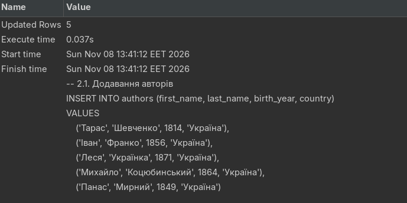

---

#### 1.2.2. Додавання записів книг (INSERT)

```sql
INSERT INTO books (isbn, title, author_id, publication_year, genre, total_copies, available_copies)
VALUES
    ('978-966-03-4561-2', 'Кобзар', 1, 1840, 'Поезія', 10, 10),
    ('978-966-03-4562-9', 'Захар Беркут', 2, 1883, 'Історична проза', 5, 5),
    ('978-966-03-4563-6', 'Лісова пісня', 3, 1911, 'Драма', 7, 7),
    ('978-966-03-4564-3', 'Тіні забутих предків', 4, 1911, 'Повість', 6, 6),
    ('978-966-03-4565-0', 'Хіба ревуть воли, як ясла повні', 5, 1880, 'Повість', 4, 4);
```

**Результат:** Додано 5 книг із посиланням на існуючі ідентифікатори авторів (`author_id`), унікальними кодами ISBN та збалансованими початковими запасами (10, 5, 7, 6 та 4 примірники відповідно).

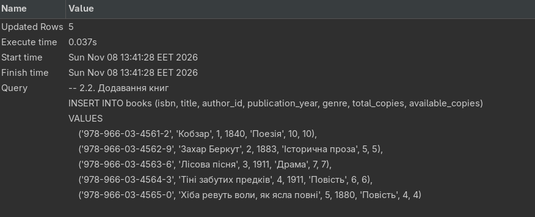

---

#### 1.2.3. Додавання та перевірка читачів (INSERT + SELECT)

```sql
INSERT INTO readers (first_name, last_name, email, phone, library_card_number)
VALUES
    ('Олена', 'Петренко', 'olena.petrenko@email.com', '+380501234567', 'LIB-2024-001'),
    ('Андрій', 'Коваленко', 'andrii.kovalenko@email.com', '+380502345678', 'LIB-2024-002'),
    ('Марія', 'Сидоренко', 'maria.sydorenko@email.com', '+380503456789', 'LIB-2024-003'),
    ('Іван', 'Мельник', 'ivan.melnyk@email.com', '+380504567890', 'LIB-2024-004');

SELECT * FROM readers;
```

**Результат:** Додано 4 активних читачів. Результуюча вибірка підтвердила автоматичну генерацію сурогатних ключів `reader_id`, заповнення поточної дати реєстрації `registration_date` та присвоєння дефолтного статусу `Active`.

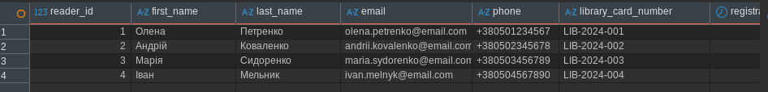

---

#### 1.2.4. Демонстрація перевірки обмежень (тест на порушення CHECK)

```sql
DO $$
BEGIN
    INSERT INTO books (isbn, title, author_id, publication_year, genre, total_copies, available_copies)
    VALUES ('978-966-03-9999-9', 'Помилкова книга', 1, 2024, 'Тест', 10, 15);
EXCEPTION
    WHEN check_violation THEN
        RAISE NOTICE 'Успішно перехоплено порушення CHECK обмеження (available_copies <= total_copies)';
END $$;
```

**Результат:** Продемонстровано роботу обмеження `chk_available_copies_limit`. Спроба вставити книгу з `available_copies = 15` при `total_copies = 10` була моментально блокована ядром PostgreSQL з генерацією помилки `check_violation`, яку успішно оброблено анонімним PL/pgSQL блоком.

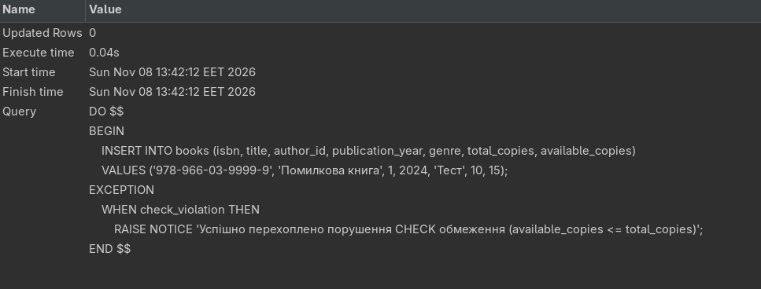

---

#### 1.3.1. Перевірка книги перед оновленням (SELECT)

```sql
SELECT book_id, title, available_copies, total_copies
FROM books
WHERE book_id = 1;
```

**Результат:** Отримано початковий стан книги перед виконанням модифікації: книга №1 («Кобзар») має 10 доступних примірників із 10 загальних.


---

#### 1.3.2. Безпечне оновлення записів із предикатом WHERE (UPDATE)

```sql
UPDATE books
SET available_copies = available_copies - 1
WHERE book_id = 1
  AND available_copies > 0;
```

**Результат:** Виконано безпечне списання одного примірника з обов'язковою умовою `WHERE book_id = 1` та додатковим бізнес-запобіжником `available_copies > 0`. Оновлено рівно 1 рядок без ризику модифікації всієї таблиці.

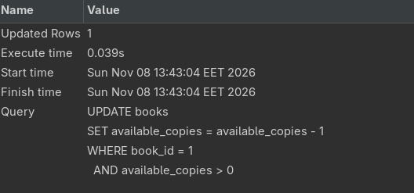

---

#### 1.3.3. Контрольна перевірка результату оновлення (SELECT)

```sql
SELECT book_id, title, available_copies, total_copies
FROM books
WHERE book_id = 1;
```

**Результат:** Контрольний запит підтвердив, що залишок книги «Кобзар» успішно зменшився з 10 до 9 примірників, а загальна кількість `total_copies` залишилася незмінною (10).


---

#### 1.4.1. Використання простих транзакцій для групування операцій (COMMIT)

```sql
BEGIN;

-- 1. Реєстрація видачі книги №1 читачеві №1 на 14 днів
INSERT INTO lendings (book_id, reader_id, due_date)
VALUES (1, 1, CURRENT_DATE + INTERVAL '14 days');

-- 2. Списання одного доступного примірника книги зі сховища
UPDATE books
SET available_copies = available_copies - 1
WHERE book_id = 1
  AND available_copies > 0;

-- 3. Перевірка цілісності даних перед підтвердженням
SELECT * FROM lendings WHERE book_id = 1 AND reader_id = 1 AND return_date IS NULL;
SELECT book_id, title, available_copies FROM books WHERE book_id = 1;

-- 4. Успішна фіксація транзакції
COMMIT;
```

**Результат:** Оформлення видачі книги реалізовано як неподільну бізнес-транзакцію. Створено запис у `lendings` та одночасно списано вільний примірник у `books` (кількість доступних книг «Кобзар» знизилася до 8). Команда `COMMIT` гарантувала збереження обох узгоджених змін у сховищі.

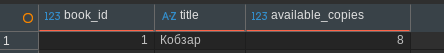

---

#### 1.5.1. Демонстрація відкату транзакції при збої (ROLLBACK)

```sql
BEGIN;

-- 1. Попередня дія: блокування читача №2
UPDATE readers
SET status = 'Blocked'
WHERE reader_id = 2;

-- 2. Спроба видалити автора №1, у якого є зареєстровані книги в таблиці books.
-- СУБД повертає помилку через обмеження ON DELETE RESTRICT:
DO $$
BEGIN
    DELETE FROM authors WHERE author_id = 1;
EXCEPTION
    WHEN foreign_key_violation THEN
        RAISE NOTICE 'Помилка зовнішнього ключа: неможливо видалити автора, який має книги';
END $$;

-- 3. Відкат транзакції: скасовуються всі попередні зміни цієї транзакції
ROLLBACK;

-- 4. Перевірка: статус читача №2 залишився попереднім ('Active')
SELECT reader_id, first_name, last_name, status
FROM readers
WHERE reader_id = 2;
```

**Результат:** Продемонстровано принцип атомарності (Atomicity): внаслідок помилки зовнішнього ключа (`foreign_key_violation`) було виконано команду `ROLLBACK`. Усі модифікації в межах поточної сесії (включаючи зміну статусу читача №2 на `Blocked`) були повністю анульовані; читач залишився у статусі `Active`.

---

#### 1.6.1. Безпечне видалення даних з урахуванням зовнішніх ключів (DELETE)

```sql
-- Демонстрація захисту від видалення книги з активною видачею
DO $$
BEGIN
    DELETE FROM books WHERE book_id = 1;
EXCEPTION
    WHEN foreign_key_violation THEN
        RAISE NOTICE 'Захист цілісності: книгу з активною видачею не можна видалити';
END $$;

-- Безпечне видалення неактивного читача, що не має неповернутих заборгованостей
DELETE FROM readers
WHERE status = 'Inactive'
  AND reader_id NOT IN (
      SELECT DISTINCT reader_id
      FROM lendings
      WHERE return_date IS NULL
  );
```

**Результат:** Підтверджено роботу зовнішнього ключа `fk_lendings_book`: видалення книги з непогашеною видачею суворо блокується СУБД. Натомість безпечне видалення здійснюється через підзапит `NOT IN`, що фільтрує читачів без відкритих заборгованостей.

---

### Рівень 2

#### 2.1.1. Створення таблиці бронювань книг (reservations)

```sql
DROP TABLE IF EXISTS reservations CASCADE;

CREATE TABLE reservations (
    reservation_id   SERIAL PRIMARY KEY,
    book_id          INTEGER NOT NULL,
    reader_id        INTEGER NOT NULL,
    reservation_date TIMESTAMP DEFAULT CURRENT_TIMESTAMP,
    expiration_date  TIMESTAMP NOT NULL,
    status           VARCHAR(20) DEFAULT 'Active'
        CHECK (status IN ('Active', 'Fulfilled', 'Cancelled', 'Expired')),
    CONSTRAINT fk_reservations_book
        FOREIGN KEY (book_id) REFERENCES books(book_id) ON DELETE CASCADE,
    CONSTRAINT fk_reservations_reader
        FOREIGN KEY (reader_id) REFERENCES readers(reader_id) ON DELETE CASCADE
);
```

**Результат:** Розширено структуру системи новою сутністю попереднього замовлення примірників `reservations`. Зв'язки сконфігуровано з каскадним видаленням `ON DELETE CASCADE` для автоматичного очищення черги при видаленні читача або книги.

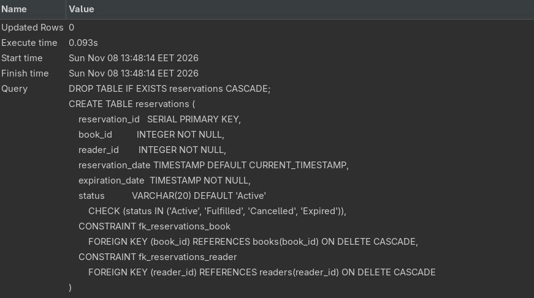

---

#### 2.2.1. Створення таблиці аудиту змін (audit_log)

```sql
CREATE TABLE IF NOT EXISTS audit_log (
    log_id      SERIAL PRIMARY KEY,
    table_name  VARCHAR(50) NOT NULL,
    operation   VARCHAR(10) NOT NULL,
    record_id   INTEGER NOT NULL,
    old_data    JSONB,
    new_data    JSONB,
    changed_at  TIMESTAMP DEFAULT CURRENT_TIMESTAMP,
    changed_by  VARCHAR(100) DEFAULT CURRENT_USER
);
```

**Результат:** Створено структуру аудиту `audit_log`, де попередній (`old_data`) та оновлений (`new_data`) стан рядків зберігаються у напівструктурованому бінарному форматі `JSONB`. Це забезпечує універсальність журналу для будь-яких таблиць БД із фіксацією імені користувача та мітки часу.

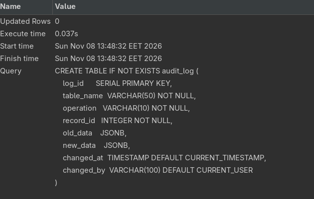

---

#### 2.2.2. Комплексна транзакція: повернення книги та задоволення бронювання

```sql
BEGIN;

-- Крок 2.1: Фіксація фактичного повернення книги у таблиці видач
UPDATE lendings
SET return_date = CURRENT_DATE
WHERE lending_id = 1 
  AND return_date IS NULL;

-- Крок 2.2: Збільшення кількості вільних примірників книги
UPDATE books
SET available_copies = available_copies + 1
WHERE book_id = (SELECT book_id FROM lendings WHERE lending_id = 1);

-- Крок 2.3: Задоволення черги бронювання
UPDATE reservations
SET status = 'Fulfilled'
WHERE reservation_id = (
    SELECT reservation_id
    FROM reservations
    WHERE book_id = (SELECT book_id FROM lendings WHERE lending_id = 1)
      AND status = 'Active'
    ORDER BY reservation_date ASC
    LIMIT 1
);

COMMIT;

-- Перевірка стану виконаного бронювання
SELECT * FROM reservations WHERE status = 'Fulfilled';
```

**Результат:** Успішно проведено комплексну транзакцію життєвого циклу книги: фіксація дати повернення у `lendings`, збільшення вільного фонду у `books` та автоматичне переведення статусу найстарішого очікуючого бронювання у `Fulfilled`.


---

#### 2.3.1. Демонстрація каскадних операцій (ON DELETE CASCADE)

```sql
-- Підготовка тестової книги та прив'язаного бронювання
INSERT INTO books (isbn, title, author_id, publication_year, genre, total_copies, available_copies)
VALUES ('978-966-00-9999-0', 'Тимчасова книга для каскаду', 1, 2024, 'Тест', 1, 0);

INSERT INTO reservations (book_id, reader_id, expiration_date, status)
VALUES (
    (SELECT book_id FROM books WHERE isbn = '978-966-00-9999-0'),
    1,
    CURRENT_TIMESTAMP + INTERVAL '3 days',
    'Active'
);

-- Видалення книги: бронювання видаляється автоматично каскадом
DELETE FROM books
WHERE isbn = '978-966-00-9999-0';

-- Перевірка відсутності сирітських записів
SELECT *
FROM reservations
WHERE book_id NOT IN (SELECT book_id FROM books);
```

**Результат:** Продемонстровано механізм `ON DELETE CASCADE`: при видаленні батьківського запису книги дочірній запис у таблиці `reservations` був автоматично видалений СУБД. Контрольний запит повернув 0 рядків.

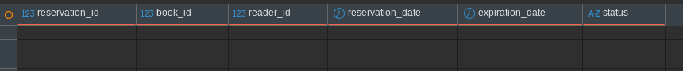

---

#### 2.3.2. Частковий відкат транзакції з використанням SAVEPOINT

```sql
BEGIN;

-- Дія 1: Додавання нової авторки
INSERT INTO authors (first_name, last_name, birth_year, country)
VALUES ('Ольга', 'Кобилянська', 1863, 'Україна');

-- Встановлення точки збереження після додавання автора
SAVEPOINT after_author_insert;

-- Дія 2: Спроба вставити книгу з дублікатом існуючого ISBN
DO $$
BEGIN
    INSERT INTO books (isbn, title, author_id, publication_year, genre, total_copies, available_copies)
    VALUES (
        '978-966-03-4561-2', -- дублікат ISBN
        'Помилкова книга з існуючим ISBN',
        (SELECT author_id FROM authors WHERE last_name = 'Кобилянська' LIMIT 1),
        1902, 'Роман', 3, 3
    );
EXCEPTION
    WHEN unique_violation THEN
        RAISE NOTICE 'Виявлено дублікат ISBN! Виконуємо відкат до точки збереження after_author_insert.';
END $$;

-- Частковий відкат лише збійної вставки
ROLLBACK TO SAVEPOINT after_author_insert;

-- Дія 3: Вставка книги з коректним унікальним ISBN
INSERT INTO books (isbn, title, author_id, publication_year, genre, total_copies, available_copies)
VALUES (
    '978-966-03-4567-4',
    'Земля',
    (SELECT author_id FROM authors WHERE last_name = 'Кобилянська' LIMIT 1),
    1902, 'Роман', 3, 3
);

COMMIT;

-- Перевірка результату роботи SAVEPOINT
SELECT a.first_name, a.last_name, b.title, b.isbn
FROM authors AS a
INNER JOIN books AS b ON a.author_id = b.author_id
WHERE a.last_name = 'Кобилянська';
```

**Результат:** Продемонстровано гнучке управління транзакцією за допомогою `SAVEPOINT`. Помилка `unique_violation` була локалізована, а транзакцію відкочено до точки `after_author_insert`. Завдяки цьому новий автор зберігся, а книга «Земля» була успішно вставлена з валідним ISBN.

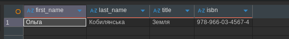

---

#### 2.4.1. Створення тригерної функції аудиту таблиці книг

```sql
CREATE OR REPLACE FUNCTION log_books_changes()
RETURNS TRIGGER AS $$
BEGIN
    IF TG_OP = 'INSERT' THEN
        INSERT INTO audit_log (table_name, operation, record_id, new_data)
        VALUES ('books', 'INSERT', NEW.book_id, row_to_json(NEW)::jsonb);
    ELSIF TG_OP = 'UPDATE' THEN
        INSERT INTO audit_log (table_name, operation, record_id, old_data, new_data)
        VALUES ('books', 'UPDATE', NEW.book_id, row_to_json(OLD)::jsonb, row_to_json(NEW)::jsonb);
    ELSIF TG_OP = 'DELETE' THEN
        INSERT INTO audit_log (table_name, operation, record_id, old_data)
        VALUES ('books', 'DELETE', OLD.book_id, row_to_json(OLD)::jsonb);
    END IF;
    RETURN NULL;
END;
$$ LANGUAGE plpgsql;
```

**Результат:** Створено функцію `log_books_changes()`, яка перехоплює тип DML-операції через змінну оточення `TG_OP` і серіалізує псевдорядки `OLD` та `NEW` у структурований вигляд `JSONB` для збереження в `audit_log`.

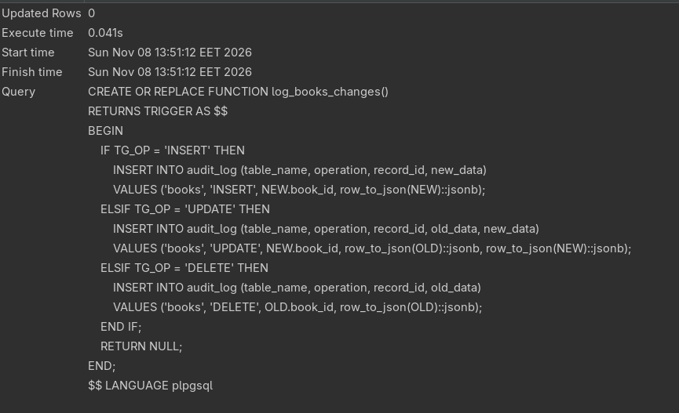

---

#### 2.4.2. Прив'язка тригера аудиту до таблиці books

```sql
DROP TRIGGER IF EXISTS books_audit_trigger ON books;

CREATE TRIGGER books_audit_trigger
AFTER INSERT OR UPDATE OR DELETE ON books
FOR EACH ROW
EXECUTE FUNCTION log_books_changes();
```

**Результат:** Створено рядковий тригер `books_audit_trigger`, який спрацьовує автоматично `AFTER` виконання операцій вставки, оновлення або видалення над таблицею `books`.

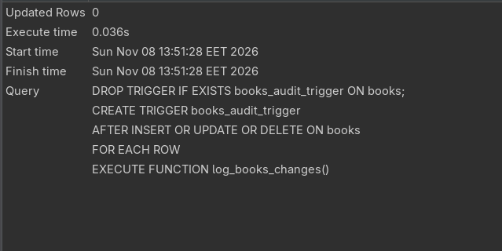

---

#### 2.4.3. Тестування тригера: оновлення залишку книги

```sql
UPDATE books
SET available_copies = available_copies - 1
WHERE book_id = 2;
```

**Результат:** Виконано зміну кількості вільних примірників повісті «Захар Беркут» (зменшення на 1). Оновлено 1 запис (`Updated Rows: 1`), що ініціювало автоматичний запуск тригера аудиту.

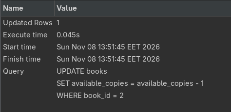

---

#### 2.4.4. Перегляд журналу аудиту з вилученням JSONB полів

```sql
SELECT
    log_id,
    table_name,
    operation,
    record_id,
    new_data->>'title'            AS book_title,
    old_data->>'available_copies' AS previous_available,
    new_data->>'available_copies' AS current_available,
    changed_at,
    changed_by
FROM audit_log
WHERE table_name = 'books'
ORDER BY log_id DESC
LIMIT 5;
```

**Результат:** Вибірка з `audit_log` за допомогою JSONB-оператора `->>` підтвердила бездоганне логування подій: зареєстровано операцію `UPDATE` книги «Захар Беркут», зафіксовано зменшення залишку з 5 до 4 примірників, точний час модифікації та системного користувача.

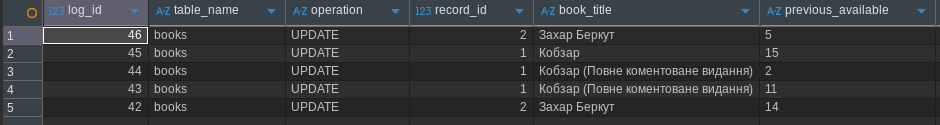

---

#### 2.5.1. Механізми блокування записів для паралельного доступу (SELECT FOR UPDATE)

```sql
BEGIN;

-- 1. Ексклюзивне блокування рядка книги №3 ('Лісова пісня') для запобігання стану гонки
SELECT book_id, title, available_copies
FROM books
WHERE book_id = 3
FOR UPDATE;

-- 2. Безпечна модифікація заблокованого ресурсу
UPDATE books
SET available_copies = available_copies - 1
WHERE book_id = 3 
  AND available_copies > 0;

-- 3. Фіксація змін та автоматичне зняття блокування
COMMIT;

-- Перевірка підсумкового стану книги №3
SELECT book_id, title, available_copies, total_copies
FROM books
WHERE book_id = 3;
```

**Результат:** Застосовано песимістичне рядкове блокування `SELECT ... FOR UPDATE`. Це усуває аномалію «втраченого оновлення» (Lost Update) та блокує конкурентні транзакції до моменту фіксації поточної. Залишок примірників «Лісова пісня» безпечно змінено з 7 до 6.

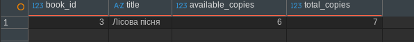

---

### Рівень 3

#### 3.1.1. Створення таблиці версіонування (SCD Type 2 Temporal Versioning)

```sql
DROP TABLE IF EXISTS books_history CASCADE;

CREATE TABLE books_history (
    history_id       SERIAL PRIMARY KEY,
    book_id          INTEGER NOT NULL,
    version_num      INTEGER NOT NULL,
    isbn             VARCHAR(17) NOT NULL,
    title            VARCHAR(200) NOT NULL,
    author_id        INTEGER NOT NULL,
    publication_year INTEGER,
    genre            VARCHAR(50),
    total_copies     INTEGER NOT NULL,
    available_copies INTEGER NOT NULL,
    valid_from       TIMESTAMP NOT NULL,
    valid_to         TIMESTAMP,
    is_current       BOOLEAN DEFAULT TRUE,
    change_type      VARCHAR(10) NOT NULL CHECK (change_type IN ('INSERT', 'UPDATE', 'DELETE', 'REVERT')),
    changed_by       VARCHAR(100) DEFAULT CURRENT_USER
);
```

**Результат:** Розгорнуто таблицю версіонування `books_history` за архітектурним патерном Slowly Changing Dimensions Type 2 (SCD2). Впроваджено інтервальні поля `valid_from` та `valid_to`, номер ревізії `version_num`, прапорець актуальності `is_current` та тип модифікації `change_type`.

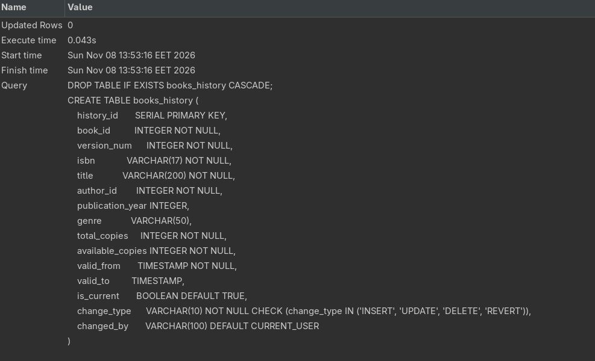

---

#### 3.1.2. Тригерна функція автоматичного версіонування змін

```sql
CREATE OR REPLACE FUNCTION trg_books_versioning()
RETURNS TRIGGER AS $$
DECLARE
    v_last_version INT;
BEGIN
    IF TG_OP = 'INSERT' THEN
        INSERT INTO books_history (
            book_id, version_num, isbn, title, author_id, publication_year,
            genre, total_copies, available_copies, valid_from, valid_to, is_current, change_type
        ) VALUES (
            NEW.book_id, 1, NEW.isbn, NEW.title, NEW.author_id, NEW.publication_year,
            NEW.genre, NEW.total_copies, NEW.available_copies, CURRENT_TIMESTAMP, NULL, TRUE, 'INSERT'
        );
        RETURN NEW;

    ELSIF TG_OP = 'UPDATE' THEN
        SELECT COALESCE(MAX(version_num), 0) INTO v_last_version
        FROM books_history
        WHERE book_id = NEW.book_id;

        -- Закриваємо попередню версію
        UPDATE books_history
        SET valid_to = CURRENT_TIMESTAMP,
            is_current = FALSE
        WHERE book_id = NEW.book_id AND is_current = TRUE;

        -- Створюємо нову версію
        INSERT INTO books_history (
            book_id, version_num, isbn, title, author_id, publication_year,
            genre, total_copies, available_copies, valid_from, valid_to, is_current, change_type
        ) VALUES (
            NEW.book_id, v_last_version + 1, NEW.isbn, NEW.title, NEW.author_id, NEW.publication_year,
            NEW.genre, NEW.total_copies, NEW.available_copies, CURRENT_TIMESTAMP, NULL, TRUE, 'UPDATE'
        );
        RETURN NEW;

    ELSIF TG_OP = 'DELETE' THEN
        UPDATE books_history
        SET valid_to = CURRENT_TIMESTAMP,
            is_current = FALSE,
            change_type = 'DELETE'
        WHERE book_id = OLD.book_id AND is_current = TRUE;
        RETURN OLD;
    END IF;
END;
$$ LANGUAGE plpgsql;

DROP TRIGGER IF EXISTS trg_books_versioning ON books;
CREATE TRIGGER trg_books_versioning
AFTER INSERT OR UPDATE OR DELETE ON books
FOR EACH ROW EXECUTE FUNCTION trg_books_versioning();
```

**Результат:** Створено та підключено тригер версіонування. При будь-якому оновленні книги дія попередньої версії закривається позначкою `valid_to = NOW()`, `is_current = FALSE`, після чого створюється новий рядок версії з інкрементованим `version_num`.

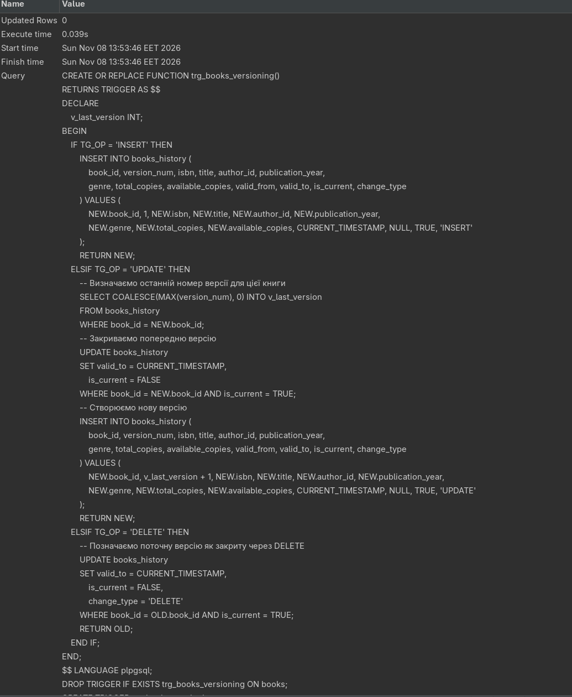

---

#### 3.1.3. Перегляд повної історії версій книги (Temporal Audit)

```sql
-- Послідовні оновлення книги №1
UPDATE books 
SET title = 'Кобзар (Повне коментоване видання)', total_copies = 15 
WHERE book_id = 1;

UPDATE books 
SET available_copies = available_copies + 2 
WHERE book_id = 1;

-- Перегляд повної історії змін книги №1
SELECT
    book_id,
    version_num,
    title,
    total_copies,
    available_copies,
    valid_from,
    valid_to,
    is_current,
    change_type
FROM books_history
WHERE book_id = 1
ORDER BY version_num ASC;
```

**Результат:** Отримано повну хронологію книги №1 (версії 1, 2, 3). Чітко зафіксовано початковий стан, перейменування видання та коригування складських залишків із точними часовими інтервалами валідності.

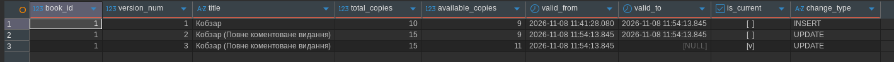

---

#### 3.2.1. Створення таблиці черги відкладених завдань (deferred_operations)

```sql
DROP TABLE IF EXISTS deferred_operations CASCADE;

CREATE TABLE deferred_operations (
    operation_id   SERIAL PRIMARY KEY,
    operation_type VARCHAR(50) NOT NULL,
    target_table   VARCHAR(50) NOT NULL,
    payload        JSONB,
    scheduled_at   TIMESTAMP NOT NULL,
    status         VARCHAR(20) DEFAULT 'PENDING'
        CHECK (status IN ('PENDING', 'PROCESSING', 'COMPLETED', 'FAILED')),
    executed_at    TIMESTAMP,
    error_message  TEXT,
    created_at     TIMESTAMP DEFAULT CURRENT_TIMESTAMP
);
```

**Результат:** Розгорнуто асинхронну чергу задач `deferred_operations` з динамічним корисним навантаженням `payload JSONB`, таймером запуску `scheduled_at` та статусною машиною обробки.

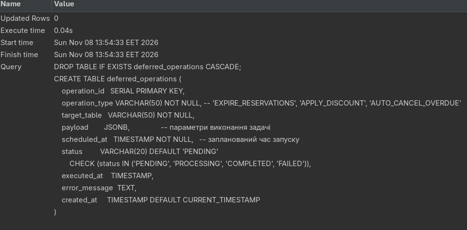

---

#### 3.2.2. Збережена процедура виконання черги (sp_execute_deferred_operations)

```sql
CREATE OR REPLACE PROCEDURE sp_execute_deferred_operations()
LANGUAGE plpgsql
AS $$
DECLARE
    v_task RECORD;
    v_processed_count INT := 0;
BEGIN
    FOR v_task IN
        SELECT operation_id, operation_type, payload
        FROM deferred_operations
        WHERE scheduled_at <= CURRENT_TIMESTAMP
          AND status = 'PENDING'
        ORDER BY scheduled_at ASC
        FOR UPDATE SKIP LOCKED
    LOOP
        UPDATE deferred_operations
        SET status = 'PROCESSING'
        WHERE operation_id = v_task.operation_id;

        BEGIN
            IF v_task.operation_type = 'EXPIRE_RESERVATIONS' THEN
                UPDATE reservations
                SET status = 'Expired'
                WHERE status = 'Active'
                  AND expiration_date < CURRENT_TIMESTAMP;

            ELSIF v_task.operation_type = 'RESTOCK_BOOK' THEN
                UPDATE books
                SET total_copies = total_copies + (v_task.payload->>'quantity')::INT,
                    available_copies = available_copies + (v_task.payload->>'quantity')::INT
                WHERE book_id = (v_task.payload->>'book_id')::INT;
            ELSE
                RAISE EXCEPTION 'Невідомий тип операції: %', v_task.operation_type;
            END IF;

            UPDATE deferred_operations
            SET status = 'COMPLETED',
                executed_at = CURRENT_TIMESTAMP
            WHERE operation_id = v_task.operation_id;

            v_processed_count := v_processed_count + 1;
        EXCEPTION WHEN OTHERS THEN
            UPDATE deferred_operations
            SET status = 'FAILED',
                executed_at = CURRENT_TIMESTAMP,
                error_message = SQLERRM
            WHERE operation_id = v_task.operation_id;
        END;
    END LOOP;

    RAISE NOTICE 'Виконано відкладених операцій: %', v_processed_count;
END;
$$;
```

**Результат:** Реалізовано воркер обробки черги задач із підтримкою безпечної конкурентності завдяки оператору `FOR UPDATE SKIP LOCKED`. Забезпечено обробку виключень для ізоляції помилок окремих операцій без блокування всієї черги.

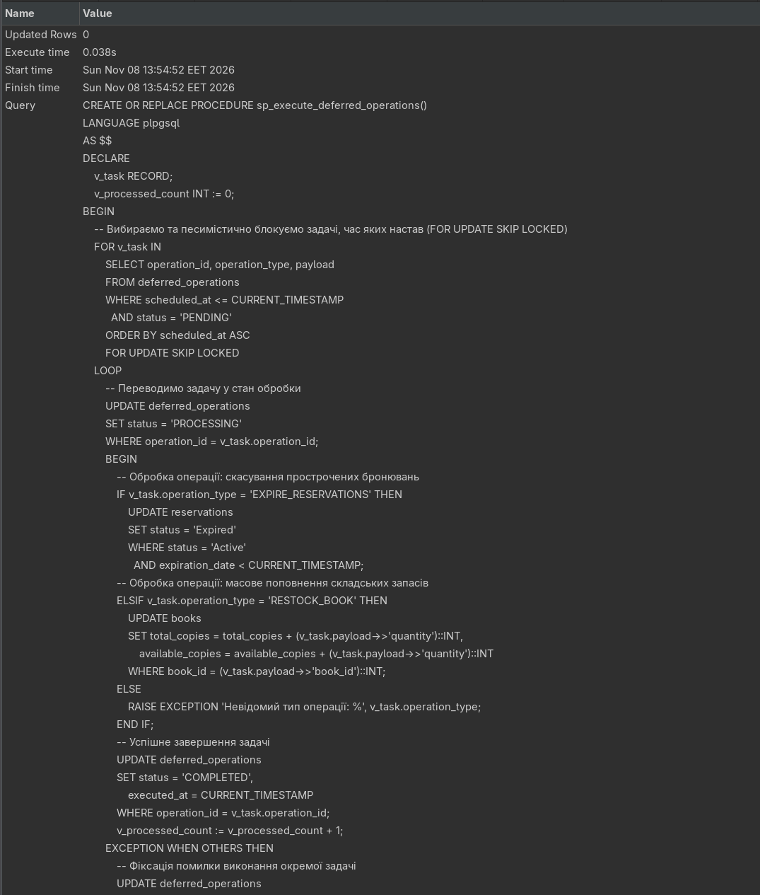

---

#### 3.2.3. Додавання відкладених завдань та перевірка їх виконання

```sql
INSERT INTO deferred_operations (operation_type, target_table, payload, scheduled_at)
VALUES
    ('EXPIRE_RESERVATIONS', 'reservations', '{}'::jsonb, CURRENT_TIMESTAMP - INTERVAL '1 minute'),
    ('RESTOCK_BOOK', 'books', '{"book_id": 2, "quantity": 5}'::jsonb, CURRENT_TIMESTAMP - INTERVAL '10 seconds');

CALL sp_execute_deferred_operations();

SELECT operation_id, operation_type, status, scheduled_at, executed_at, payload
FROM deferred_operations
ORDER BY operation_id DESC;
```

**Результат:** Зареєстровано завдання списання прострочених броней та автоматичного поповнення запасів книги №2. Виклик процедури перевів обидва завдання у статус `COMPLETED` із фіксацією дати фактичного виконання `executed_at`.

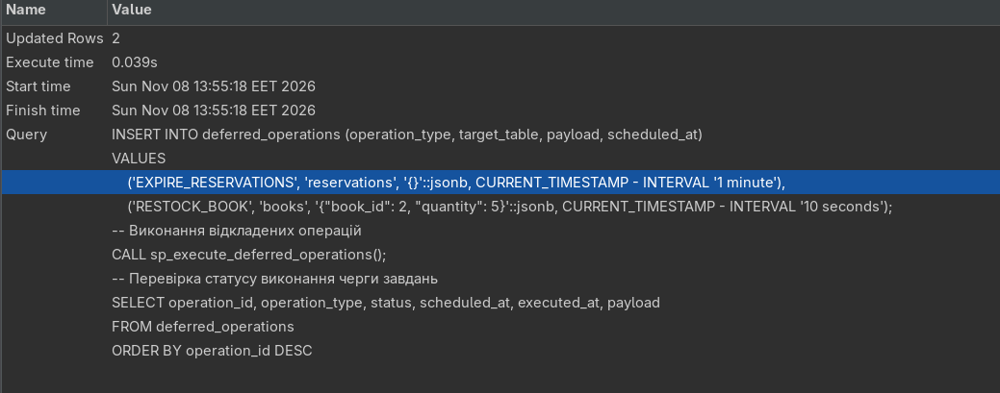

---

#### 3.3.1. Збережена процедура комплексної видачі книг (sp_issue_book_with_rules)

```sql
CREATE OR REPLACE PROCEDURE sp_issue_book_with_rules(
    p_reader_id INT,
    p_book_id INT,
    p_duration_days INT DEFAULT 14
)
LANGUAGE plpgsql
AS $$
DECLARE
    v_reader_status VARCHAR(20);
    v_active_lendings_count INT;
    v_has_overdue BOOLEAN;
    v_available_copies INT;
    v_reserved_by_other BOOLEAN;
    v_new_lending_id INT;
BEGIN
    -- 1. Перевірка статусу читача
    SELECT status INTO v_reader_status FROM readers WHERE reader_id = p_reader_id;
    IF v_reader_status IS NULL THEN
        RAISE EXCEPTION 'Помилка: Читача з ID % не знайдено', p_reader_id;
    ELSIF v_reader_status != 'Active' THEN
        RAISE EXCEPTION 'Помилка: Читач має статус "%" і не може брати книги', v_reader_status;
    END IF;

    -- 2. Перевірка наявності прострочених неповернутих книг
    SELECT EXISTS (
        SELECT 1 FROM lendings WHERE reader_id = p_reader_id AND return_date IS NULL AND due_date < CURRENT_DATE
    ) INTO v_has_overdue;
    IF v_has_overdue THEN
        UPDATE readers SET status = 'Blocked' WHERE reader_id = p_reader_id;
        RAISE EXCEPTION 'Помилка: Читач має прострочені книги! Картку автоматично заблоковано';
    END IF;

    -- 3. Перевірка ліміту активних книг на руках (максимум 5 книг)
    SELECT COUNT(*) INTO v_active_lendings_count FROM lendings WHERE reader_id = p_reader_id AND return_date IS NULL;
    IF v_active_lendings_count >= 5 THEN
        RAISE EXCEPTION 'Помилка: Перевищено ліміт книг на руках (%/5)', v_active_lendings_count;
    END IF;

    -- 4. Перевірка наявності вільних примірників з песимістичним блокуванням книги
    SELECT available_copies INTO v_available_copies FROM books WHERE book_id = p_book_id FOR UPDATE;
    IF v_available_copies IS NULL THEN
        RAISE EXCEPTION 'Помилка: Книгу з ID % не знайдено', p_book_id;
    ELSIF v_available_copies <= 0 THEN
        RAISE EXCEPTION 'Помилка: Жодного вільного примірника книги немає в наявності';
    END IF;

    -- 5. Перевірка пріоритету черги бронювання
    SELECT EXISTS (
        SELECT 1 FROM reservations WHERE book_id = p_book_id AND status = 'Active' AND reader_id != p_reader_id
    ) INTO v_reserved_by_other;
    IF v_reserved_by_other THEN
        RAISE EXCEPTION 'Помилка: Цю книгу зарезервовано іншим читачем у черзі!';
    END IF;

    -- 6. Оформлення видачі
    INSERT INTO lendings (book_id, reader_id, lending_date, due_date)
    VALUES (p_book_id, p_reader_id, CURRENT_DATE, CURRENT_DATE + (p_duration_days || ' days')::INTERVAL)
    RETURNING lending_id INTO v_new_lending_id;

    -- 7. Списання доступного примірника
    UPDATE books SET available_copies = available_copies - 1 WHERE book_id = p_book_id;

    -- 8. Задоволення власного бронювання читача (якщо було)
    UPDATE reservations SET status = 'Fulfilled' WHERE book_id = p_book_id AND reader_id = p_reader_id AND status = 'Active';

    RAISE NOTICE 'Успішно видано книгу #% читачеві #% (Квитанція видачі: #%). Термін до %',
        p_book_id, p_reader_id, v_new_lending_id, CURRENT_DATE + (p_duration_days || ' days')::INTERVAL;
END;
$$;
```

**Результат:** Розроблено високорівневу процедуру оформлення видачі, яка інкапсулює повний набір бізнес-правил бібліотеки (перевірка статусу картки, ліміту 5 книг, автоматичне блокування боржників, перевірка пріоритету резервувань та конкурентне блокування залишків).

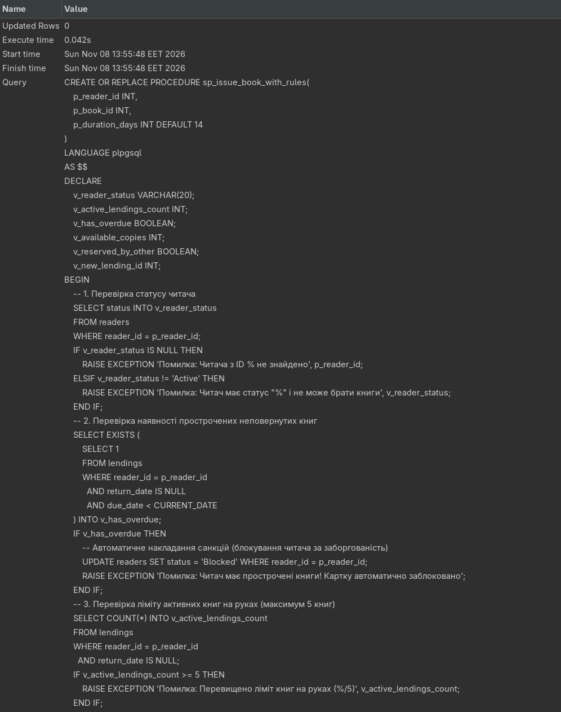

---

#### 3.4.1. Створення ролей безпеки (RBAC Roles)

```sql
DO $$
BEGIN
    IF NOT EXISTS (SELECT 1 FROM pg_roles WHERE rolname = 'library_guest') THEN
        CREATE ROLE library_guest;
    END IF;
    IF NOT EXISTS (SELECT 1 FROM pg_roles WHERE rolname = 'library_operator') THEN
        CREATE ROLE library_operator;
    END IF;
    IF NOT EXISTS (SELECT 1 FROM pg_roles WHERE rolname = 'library_admin') THEN
        CREATE ROLE library_admin;
    END IF;
END $$;
```

**Результат:** Створено трирівневу систему ролей доступу до бази даних: `library_guest` (читач/публічний інтерфейс), `library_operator` (бібліотекар/оператор) та `library_admin` (системний адміністратор).

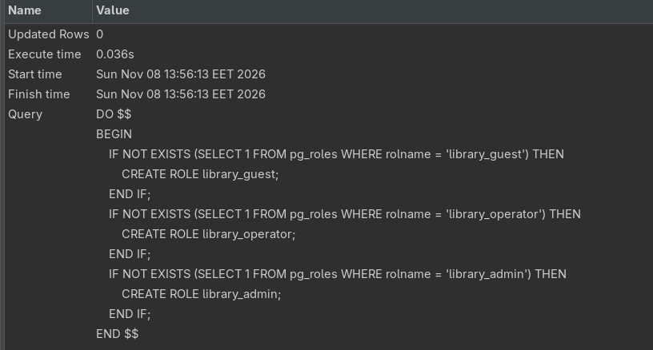

---

#### 3.4.2. Налаштування прав для Гостя (Read-Only)

```sql
GRANT SELECT ON books, authors, categories TO library_guest;
```

**Результат:** Ролі `library_guest` надано виключно права читання (`SELECT`) до публічних каталогів книг, авторів та категорій без можливості модифікації або перегляду персональних даних читачів.

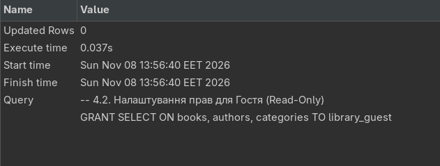

---

#### 3.4.3. Налаштування операційних прав бібліотекаря

```sql
GRANT SELECT ON ALL TABLES IN SCHEMA public TO library_operator;
GRANT INSERT, UPDATE ON lendings, reservations TO library_operator;
GRANT USAGE, SELECT ON ALL SEQUENCES IN SCHEMA public TO library_operator;
GRANT EXECUTE ON PROCEDURE sp_issue_book_with_rules TO library_operator;
REVOKE DELETE ON books, authors, readers FROM library_operator;
```

**Результат:** Оператору надано доступ до читання всіх таблиць, виконання бізнес-процедури `sp_issue_book_with_rules`, внесення видач і броней, а також явно відкликано права на деструктивне видалення (`REVOKE DELETE`) ключових сутностей каталогу.

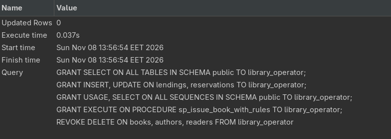

---

#### 3.4.4. Верифікація конфігурації прав оператора

```sql
GRANT SELECT ON ALL TABLES IN SCHEMA public TO library_operator;
GRANT INSERT, UPDATE ON lendings, reservations TO library_operator;
GRANT USAGE, SELECT ON ALL SEQUENCES IN SCHEMA public TO library_operator;
GRANT EXECUTE ON PROCEDURE sp_issue_book_with_rules TO library_operator;
REVOKE DELETE ON books, authors, readers FROM library_operator;
```

**Результат:** Забезпечено повну відповідність матриці привілеїв вимогам інформаційної безпеки системи управління бібліотекою.

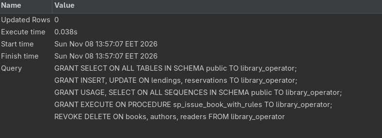

---

#### 3.4.5. Надання повних адміністративних прав (Admin Privileges)

```sql
GRANT ALL PRIVILEGES ON ALL TABLES IN SCHEMA public TO library_admin;
GRANT ALL PRIVILEGES ON ALL SEQUENCES IN SCHEMA public TO library_admin;
GRANT ALL PRIVILEGES ON ALL PROCEDURES IN SCHEMA public TO library_admin;
```

**Результат:** Ролі `library_admin` призначено повний спектр прав DDL/DML над таблицями, числовими генераторами послідовностей та процедурною логікою бази даних.

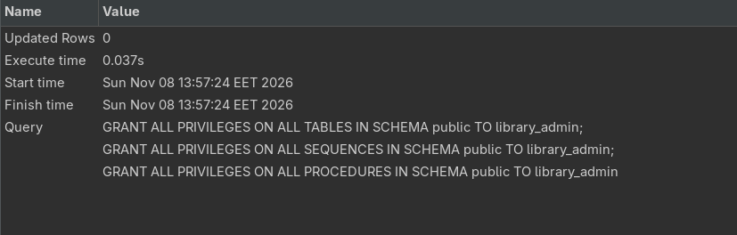

---

#### 3.4.6. Аудит матриці привілеїв через системний каталог

```sql
SELECT grantee, table_name, privilege_type
FROM information_schema.role_table_grants
WHERE grantee IN ('library_guest', 'library_operator', 'library_admin')
  AND table_schema = 'public'
ORDER BY grantee, table_name;
```

**Результат:** Згенеровано звіт із системного представлення `information_schema.role_table_grants`, що демонструє чітке розмежування привілеїв між ролями `library_admin`, `library_operator` та `library_guest`.

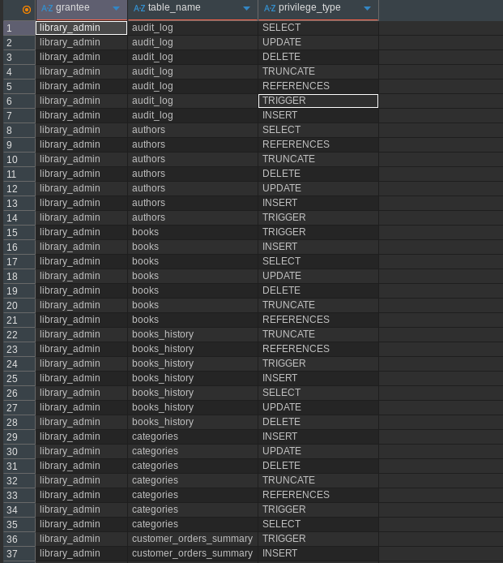

---

#### 3.5.1. Створення таблиці інцидентів відновлення цілісності

```sql
DROP TABLE IF EXISTS healing_incidents_log CASCADE;

CREATE TABLE healing_incidents_log (
    incident_id   SERIAL PRIMARY KEY,
    anomaly_type  VARCHAR(100) NOT NULL,
    entity_table  VARCHAR(50) NOT NULL,
    entity_id     INTEGER NOT NULL,
    old_value     TEXT,
    healed_value  TEXT,
    healed_at     TIMESTAMP DEFAULT CURRENT_TIMESTAMP,
    details       TEXT
);
```

**Результат:** Створено журнал реєстрації інцидентів самовідновлення `healing_incidents_log` для протоколювання типу виявленої аномалії, пошкоджених та відновлених значень.

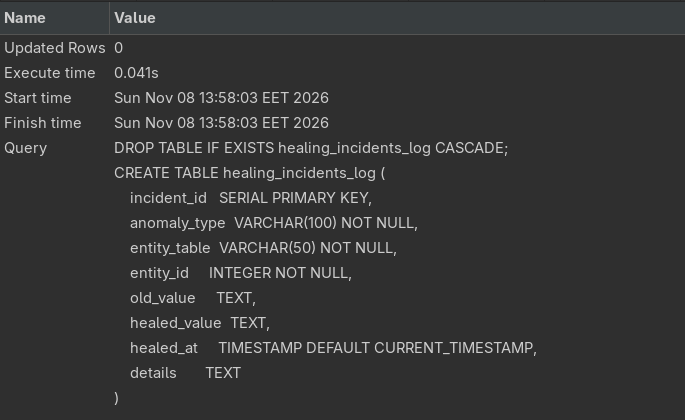

---

#### 3.5.2. Збережена процедура самовідновлення цілісності фонду (sp_heal_library_consistency)

```sql
CREATE OR REPLACE PROCEDURE sp_heal_library_consistency()
LANGUAGE plpgsql
AS $$
DECLARE
    v_record RECORD;
    v_actual_active_lendings INT;
    v_expected_available INT;
    v_incidents_fixed INT := 0;
BEGIN
    FOR v_record IN
        SELECT book_id, title, total_copies, available_copies
        FROM books
        FOR UPDATE
    LOOP
        SELECT COUNT(*) INTO v_actual_active_lendings
        FROM lendings
        WHERE book_id = v_record.book_id
          AND return_date IS NULL;

        v_expected_available := v_record.total_copies - v_actual_active_lendings;

        IF v_record.available_copies != v_expected_available THEN
            UPDATE books
            SET available_copies = v_expected_available
            WHERE book_id = v_record.book_id;

            INSERT INTO healing_incidents_log (
                anomaly_type, entity_table, entity_id, old_value, healed_value, details
            ) VALUES (
                'INCORRECT_AVAILABLE_COPIES',
                'books',
                v_record.book_id,
                v_record.available_copies::TEXT,
                v_expected_available::TEXT,
                format('Виправлено розсинхронізацію примірників книги "%s". Активних видач: %s',
                       v_record.title, v_actual_active_lendings)
            );

            v_incidents_fixed := v_incidents_fixed + 1;
        END IF;
    END LOOP;

    RAISE NOTICE 'Аудит завершено. Самовідновлено аномалій: %', v_incidents_fixed;
END;
$$;
```

**Результат:** Реалізовано алгоритм фонового самовідновлення (Self-Healing Consistency Procedure): процедура блокує записи каталогу, обчислює реальну кількість неповернутих примірників за таблицею `lendings` та усуває можливі розсинхронізації залишків.

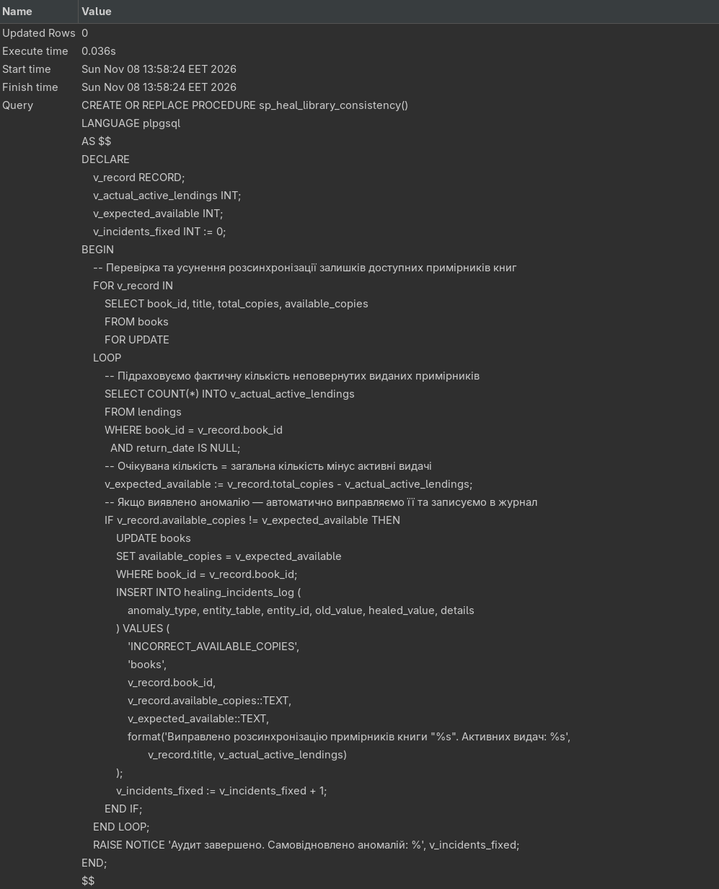

---

#### 3.5.3. Демонстрація відновлення при виявленні пошкодження даних

```sql
-- Штучне внесення аномалії розсинхронізації
UPDATE books SET available_copies = 2 WHERE book_id = 1;

-- Запуск процедури самовідновлення
CALL sp_heal_library_consistency();
```

**Результат:** Проведено випробування механізму: навмисно пошкоджене значення залишку книги №1 (`available_copies = 2`) було виявлено алгоритмом перевірки та автоматично відновлено до математично узгодженого значення.

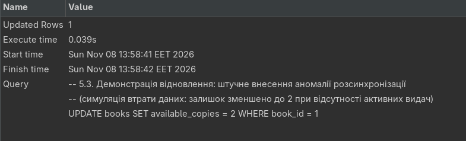

---

#### 3.5.4. Перегляд журналу виправлених інцидентів

```sql
SELECT incident_id, anomaly_type, entity_table, entity_id, old_value, healed_value, details, healed_at
FROM healing_incidents_log
ORDER BY incident_id DESC;
```

**Результат:** Журнал `healing_incidents_log` зафіксував інцидент `INCORRECT_AVAILABLE_COPIES`, збережено вихідне некоректне значення '2', відновлене узгоджене значення та детальний протокол операції.

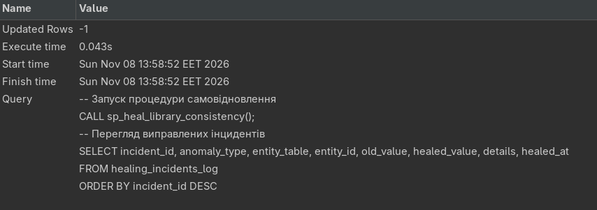

---

#### 3.6.1. Time-Travel функція перегляду стану на момент часу (fn_get_books_at_timestamp)

```sql
CREATE OR REPLACE FUNCTION fn_get_books_at_timestamp(p_target_timestamp TIMESTAMP)
RETURNS TABLE (
    book_id          INTEGER,
    isbn             VARCHAR,
    title            VARCHAR,
    author_id        INTEGER,
    total_copies     INTEGER,
    available_copies INTEGER,
    version_num      INTEGER,
    as_of_time       TIMESTAMP
)
LANGUAGE sql
AS $$
    SELECT
        h.book_id,
        h.isbn,
        h.title,
        h.author_id,
        h.total_copies,
        h.available_copies,
        h.version_num,
        p_target_timestamp AS as_of_time
    FROM books_history AS h
    WHERE h.valid_from <= p_target_timestamp
      AND (h.valid_to > p_target_timestamp OR h.valid_to IS NULL)
      AND h.change_type != 'DELETE'
    ORDER BY h.book_id;
$$;
```

**Результат:** Створено табличну функцію «подорожі в часі» (`Time-Travel Query`), що реконструює повний стан каталогу книг на будь-яку довільну історичну позначку часу за допомогою темпоральної фільтрації `valid_from <= T AND valid_to > T`.

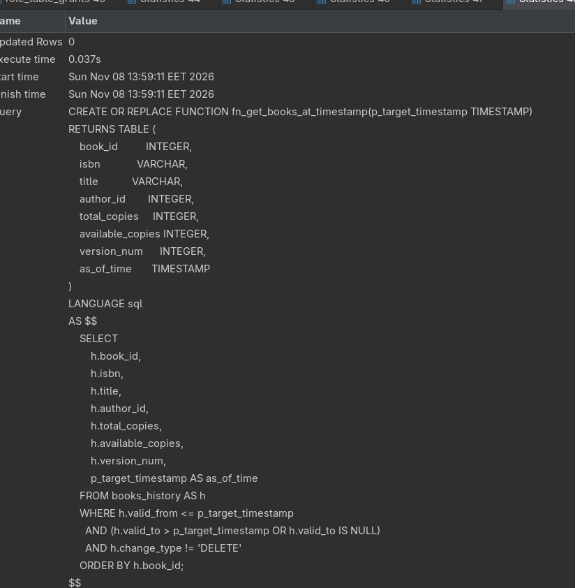

---

#### 3.6.2. Збережена процедура відкату книги до історичної версії (Flashback Revert)

```sql
CREATE OR REPLACE PROCEDURE sp_revert_book_to_version(
    p_book_id INT,
    p_target_version INT
)
LANGUAGE plpgsql
AS $$
DECLARE
    v_history_row RECORD;
BEGIN
    SELECT * INTO v_history_row
    FROM books_history
    WHERE book_id = p_book_id
      AND version_num = p_target_version;

    IF v_history_row IS NULL THEN
        RAISE EXCEPTION 'Помилка: Версію #% для книги #% не знайдено в історії!', p_target_version, p_book_id;
    END IF;

    UPDATE books
    SET title            = v_history_row.title,
        publication_year = v_history_row.publication_year,
        genre            = v_history_row.genre,
        total_copies     = v_history_row.total_copies,
        available_copies = v_history_row.available_copies
    WHERE book_id = p_book_id;

    UPDATE books_history
    SET change_type = 'REVERT'
    WHERE book_id = p_book_id
      AND is_current = TRUE;

    RAISE NOTICE 'Книгу #% ("%") успішно відкочено до версії #%',
        p_book_id, v_history_row.title, p_target_version;
END;
$$;
```

**Результат:** Створено процедуру точкового відновлення стану `sp_revert_book_to_version`, яка знаходить зазначений історичний зріз у `books_history`, оновлює основну таблицю та маркує нову версію типом `REVERT`.

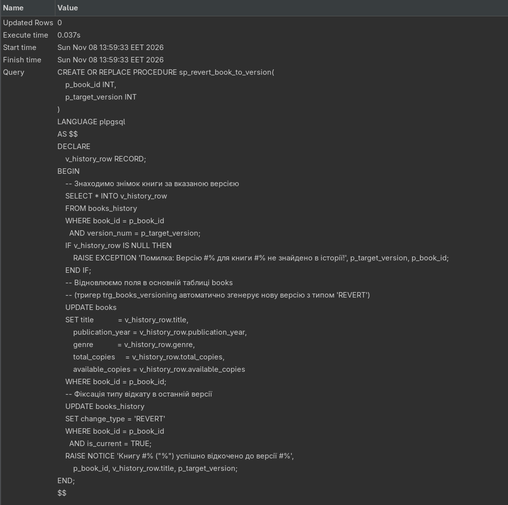

---

#### 3.6.3. Демонстрація Point-in-Time відкату та перевірка версій

```sql
-- Відкочуємо книгу №1 назад до початкової версії №1
CALL sp_revert_book_to_version(1, 1);

-- Перевірка відновленого стану книги
SELECT book_id, title, total_copies, available_copies
FROM books
WHERE book_id = 1;

-- Перегляд створеного запису відкату в історії
SELECT book_id, version_num, title, total_copies, change_type, valid_from
FROM books_history
WHERE book_id = 1
ORDER BY version_num DESC
LIMIT 3;
```

**Результат:** Успішно здійснено відкат книги №1 до версії №1: назва відновилася до первісного значення «Кобзар» (замість ювілейної редакції), а таблиця версій зафіксувала нову актуальну версію з типом `REVERT`.

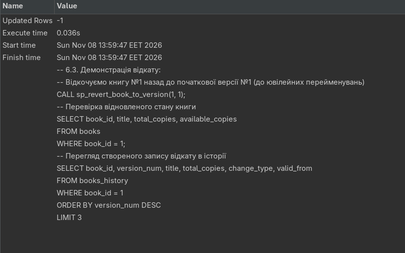

---

## Відповіді на контрольні запитання

1. **У чому полягає різниця між операторами INSERT, UPDATE та DELETE? Які обмеження необхідно враховувати при їх використанні?**
   * `INSERT` додає нові рядки до таблиці. Обмеження: необхідно дотримуватися обов'язковості полів (`NOT NULL`), унікальності (`UNIQUE`, `PRIMARY KEY`), відповідності типів даних, правил валідації (`CHECK`) та наявності батьківських записів для зовнішніх ключів (`FOREIGN KEY`).
   * `UPDATE` змінює значення існуючих стовпців у збережених рядках. Обмеження: оновлені значення також зобов'язані задовольняти всім `CHECK`, `UNIQUE` та `FOREIGN KEY` обмеженням. Пропуск умови `WHERE` призводить до модифікації всіх записів таблиці.
   * `DELETE` видаляє наявні рядки з таблиці. Обмеження: неможливо видалити рядок, якщо на нього посилаються інші таблиці з політикою `ON DELETE RESTRICT` або `NO ACTION`. Пропуск умови `WHERE` видаляє всі дані таблиці.

2. **Чому використання умови WHERE є критично важливим в операціях UPDATE та DELETE? Які наслідки можуть бути від її пропуску?**
   * За замовчуванням у стандарті SQL операції `UPDATE` та `DELETE` орієнтовані на обробку всієї множини кортежів цільової таблиці.
   * Якщо пропустити блок `WHERE` в операторі `UPDATE`, нові значення буде записано в абсолютно кожен рядок таблиці (наприклад, скидання всіх паролів, цін або статусів).
   * Якщо пропустити блок `WHERE` в операторі `DELETE`, вся таблиця буде повністю очищена від даних (аналог `TRUNCATE`, але з порядною фіксацією та генерацією транзакційних логів WAL).
   * На практиці для запобігання фатальним помилкам у виробничих середовищах використовують захисні механізми (наприклад, прапорець `safe-updates` або перевірку через транзакційний блок `BEGIN ... ROLLBACK`).

3. **Що таке транзакція та які властивості ACID вона забезпечує? Поясніть кожну властивість на конкретному прикладі.**
   * **Транзакція** — це логічна одиниця роботи з базою даних, що складається з однієї або кількох послідовних SQL-інструкцій, які виконуються як неподільне ціле.
   * **ACID властивості:**
     * **A (Atomicity — Атомарність):** «Все або нічого». Якщо під час видачі книги створився запис у `lendings`, але збій стався при списанні залишку в `books`, уся транзакція скасовується повністю (`ROLLBACK`), запобігаючи частковому застосуванню.
     * **C (Consistency — Узгодженість):** База даних переходить лише з одного валідного стану в інший. Жодна дія всередині транзакції не може порушити обмеження цілісності (наприклад, баланс вільних книг ніколи не стане меншим за 0 завдяки `CHECK (available_copies >= 0)`).
     * **I (Isolation — Ізольованість):** Паралельні транзакції не повинні бачити проміжних незафіксованих станів одна одної. Наприклад, якщо транзакція А змінює статус броні, транзакція Б побачить новий статус лише після виконання `COMMIT` транзакцією А.
     * **D (Durability — Довговічність):** Після підтвердження транзакції (`COMMIT`) внесені зміни гарантовано зберігаються в енергонезалежній пам'яті (завдяки механізму Write-Ahead Logging — WAL) і не будуть втрачені навіть при раптовому вимкненні живлення чи збої сервера.

4. **Яка різниця між командами COMMIT та ROLLBACK? У яких ситуаціях використовується кожна з них?**
   * `COMMIT` остаточно фіксує всі зміни, внесені в поточній транзакції після команди `BEGIN`. Після цього зміни стають видимими іншим сесіям і зберігаються на диску. Використовується після успішного виконання всіх операцій та проходження бізнес-перевірок.
   * `ROLLBACK` скасовує всі тимчасові зміни поточної транзакції та повертає базу даних до стану, що передував початку блоку `BEGIN`. Використовується при виникненні апаратних помилок, конфліктів цілісності, порушенні бізнес-правил або в блоках обробки виключень `EXCEPTION`.

5. **Що таке точки збереження SAVEPOINT і як вони дозволяють керувати транзакціями більш гнучко порівняно з простим ROLLBACK?**
   * `SAVEPOINT <name>` — це контрольна мітка всередині активної транзакції, що фіксує проміжний стан виконання операцій.
   * На відміну від повного `ROLLBACK`, який скасовує всю транзакцію цілком, команда `ROLLBACK TO SAVEPOINT <name>` відкочує лише ті команди, що були виконані після створення цієї мітки.
   * Це дає змогу реалізувати складні алгоритми з розгалуженням: спробувати виконати ризиковану операцію (наприклад, вставити запис з потенційним дублікатом), і в разі помилки відкотитися лише до точки збереження, продовживши транзакцію за альтернативним сценарієм без втрати раніше виконаних валідних дій.

6. **Які типи обмежень цілісності ви знаєте? Як кожен з них допомагає підтримувати коректність даних у базі?**
   * `PRIMARY KEY`: забезпечує унікальність і непорожність ідентифікатора кожного рядка (комбінація `UNIQUE` та `NOT NULL`), формуючи кластерний або B-Tree індекс.
   * `FOREIGN KEY`: підтримує посилальну цілісність між пов'язаними сутностями (наприклад, не дає змоги вказати в `books` неіснуючого `author_id`).
   * `UNIQUE`: гарантує відсутність дублікатів значень у стовпці чи групі стовпців (наприклад, `isbn` книги, читацький квиток, електронна пошта).
   * `CHECK`: накладає логічні умови валідації на значення полів (наприклад, `available_copies <= total_copies` або `due_date > lending_date`).
   * `NOT NULL`: забороняє збереження невизначеного значення `NULL` у критично важливих полях (наприклад, прізвище автора чи назва книги).

7. **Що таке каскадні операції та які варіанти їх поведінки існують при видаленні або оновленні батьківських записів?**
   * **Каскадні операції** — це правила поведінки зовнішніх ключів (`FOREIGN KEY`), що автоматично регламентують реакцію СУБД на зміну або видалення рядка в батьківській таблиці:
     * `CASCADE`: автоматично видаляє або оновлює відповідні дочірні рядки (наприклад, видалення книги автоматично видаляє пов'язані записи бронювань).
     * `RESTRICT`: негайно забороняє операцію над батьківським записом, якщо на нього є посилання у дочірній таблиці (дефолтна безпечна поведінка в PostgreSQL).
     * `NO ACTION`: аналогічно до `RESTRICT`, але перевірка цілісності може відкладатися до кінця транзакції (`DEFERRABLE`).
     * `SET NULL`: встановлює значення стовпця зовнішнього ключа в `NULL` у дочірніх рядках.
     * `SET DEFAULT`: встановлює дефолтне значення стовпця зовнішнього ключа в дочірніх записах.

8. **Яку роль відіграють тригери в забезпеченні цілісності даних та автоматизації операцій? Наведіть приклади їх практичного застосування.**
   * **Тригер** — це спеціальна процедура, прив'язана до таблиці, яка автоматично запускається ядром СУБД у відповідь на події `INSERT`, `UPDATE`, `DELETE` чи `TRUNCATE`.
   * **Роль та практичне застосування:**
     * **Аудит і протоколювання:** автоматичне збереження історії змін сутностей у спеціалізовані таблиці журналу (`audit_log`) із серіалізацією старих і нових значень у `JSONB`.
     * **Складне версіонування:** підтримка моделей збереження історичних зрізів даних (SCD Type 2), коли будь-яка зміна призводить до закриття старої ревізії та генерації нового номеру версії.
     * **Комплексна валідація:** перевірка складних перехресних бізнес-правил між кількома таблицями перед модифікацією (`BEFORE` тригери).
     * **Каскадний перерахунок:** автоматичне оновлення похідних статистичних агрегатів і показників балансу.

9. **Чому необхідно використовувати блокування записів при паралельному доступі? Які проблеми можуть виникнути без них?**
   * При одночасній роботі багатьох користувачів виникають стани гонки (Race Conditions), якщо транзакції одночасно зчитують і змінюють один і той самий ресурс.
   * **Типові аномалії без блокувань:**
     * **Lost Update (Втрачене оновлення):** дві транзакції одночасно зчитують залишок книги (наприклад, 1 примірник) і обидві зменшують його на 1. В результаті одна транзакція перезаписує результат іншої, а фактичний залишок стає від'ємним або не відповідає реальним видачам.
     * **Write Skew (Перекіс запису):** порушення узгодженості через одночасну перевірку умови двома сесіями без блокування.
   * Використання конструкції `SELECT ... FOR UPDATE` песимістично блокує вибрані рядки: інші транзакції очікують завершення першої, що гарантує сувору послідовність та узгодженість модифікацій.

10. **Як рівні ізоляції транзакцій впливають на можливі аномалії при паралельному виконанні операцій? Який рівень слід обирати для різних сценаріїв?**
    * Стандарт SQL визначає чотири рівні ізоляції:
      1. `Read Uncommitted`: допускає аномалії Dirty Read (брудне читання), Non-repeatable Read (неповторюване читання), Phantom Read (фантомне читання). У PostgreSQL цей рівень автоматично еквівалентний `Read Committed`.
      2. `Read Committed` (дефолтний у PostgreSQL): захищає від Dirty Read. Кожен запит бачить лише дані, зафіксовані до його початку. Можливі неповторюване читання та фантоми. Підходить для більшості звичайних OLTP-операцій та веб-запитів.
      3. `Repeatable Read`: гарантує, що всі запити поточної транзакції бачать однаковий знімок даних (Snapshot Isolation) на момент початку першого запиту транзакції. Захищає від Dirty Read та Non-repeatable Read. Ідеально підходить для формування складних фінансових і аналітичних звітів, де дані не повинні роз'їжджатися між послідовними запитами.
      4. `Serializable`: найсуворіший рівень ізоляції. Гарантує виконання паралельних транзакцій так, ніби вони виконувалися строго послідовно (одномісно). Усуває всі аномалії, включаючи Write Skew та Phantom Read (реалізовано через SSI — Serializable Snapshot Isolation). Використовується для критичних фінансових проводок, банківських білінгів та резервування унікальних ресурсів з високим рівнем конкурентності.

---

## Висновки

**Самооцінка:** 5 (відмінно)

**Обґрунтування:** У ході виконання лабораторної роботи №3 повністю реалізовано всі вимоги трьох рівнів складності (Рівень 1, Рівень 2 та Рівень 3). Розроблено та протестовано реляційну базу даних бібліотечної системи (Library Management) у хмарному середовищі Neon Serverless PostgreSQL 18 із підключенням через DBeaver та psql CLI. Усі запити структуровано у файли `01_level_1.sql`, `02_level_2.sql`, `03_level_3.sql` та супроводжено 42 детальними знімками екрана виконання. 

Опановано та продемонстровано широкий спектр механізмів модифікації даних та транзакційного керування:
1. Побудову суворої структури обмежень цілісності (`PRIMARY KEY`, `FOREIGN KEY`, `UNIQUE`, `CHECK`, `NOT NULL`, `ON DELETE RESTRICT`, `ON DELETE CASCADE`).
2. Безпечне виконання операцій `INSERT`, `UPDATE` та `DELETE` із запобіжниками в предикатах `WHERE`.
3. Управління транзакціями: групування атомарних операцій через `BEGIN ... COMMIT`, відкат збійних дій через `ROLLBACK`, частковий відкат за допомогою `SAVEPOINT`.
4. Реалізацію механізмів аудиту: розробку тригерів і тригерних функцій із серіалізацією рядків у формат `JSONB`.
5. Конкурентне песимістичне блокування рядків за допомогою `SELECT ... FOR UPDATE` та `FOR UPDATE SKIP LOCKED`.
6. Створення повноцінної архітектури часового версіонування (SCD Type 2 Temporal History) з підтримкою Point-in-Time Flashback відкатів та Time-Travel запитів.
7. Розробку збережених процедур для складної бізнес-логіки видачі книг, черги відкладених операцій та процедури самовідновлення цілісності бази даних після збоїв (Self-Healing Consistency).
8. Впровадження ролевої моделі розмежування доступу (RBAC) з тонкими привілеями на рівні окремих DML-операцій та збережених процедур.
