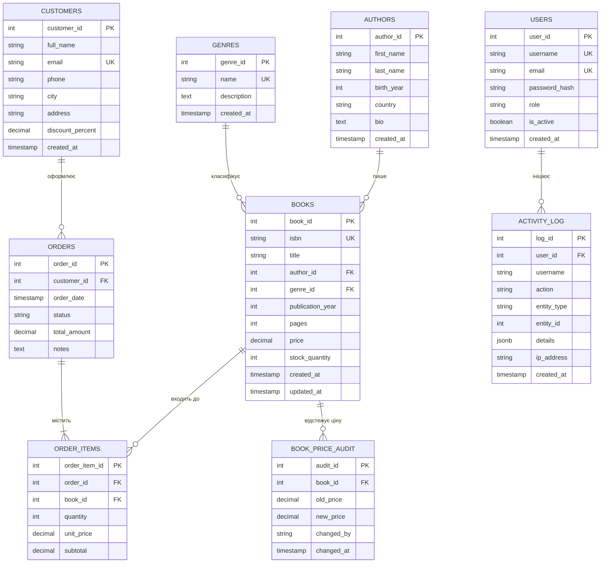

# Логічна схема та концептуальна модель бази даних книжкового магазину (Bookstore)

**Дисципліна:** Організація баз даних  
**Лабораторна робота:** №4 (Розробка реляційної бази даних з простою інтеграцією)  
**Здобувач освіти:** Панасюк Владислав Васильович  
**Група:** ІПЗ-32  
**Обраний рівень:** Рівень 3 (Високий / Відмінно, 75–100 балів)  

---

## 1. Опис предметної області

Розроблена інформаційна система призначена для комплексної автоматизації діяльності книжкового магазину (Bookstore Information System). Вона забезпечує:
* Каталогізацію літературних творів із прив'язкою до біографій авторів та жанрових категорій;
* Облік товарних залишків на складі та оперативну модифікацію цін;
* Реєстрацію покупців (клієнтів) із підтримкою програм лояльності (дисконтних знижок);
* Оформлення та фіксацію замовлень із автоматичним розрахунком фінансового обігу;
* Безпеку та розмежування прав доступу на основі ролей (RBAC: `admin`, `manager`, `user`);
* Повний аудит змін цін і дій користувачів через тригери та журнал `activity_log`.

---

## 2. Концептуальна модель (ER-діаграма)

Модель охоплює **7 ключових сутностей** предметної області (що перевищує обов'язковий мінімум у 5 сутностей) та 2 спеціалізовані сутності безпеки й аудиту.

---

## 3. Обґрунтування нормалізації (3НФ)

Спроєктована реляційна схема повністю задовольняє вимоги **Третьої нормальної форми (3NF)**:

1. **Перша нормальна форма (1НФ):**
   * Усі атрибути є строго атомарними (не містять масивів, списків чи складених полів).
   * Кожна таблиця має чітко визначений сурогатний первинний ключ (`SERIAL PRIMARY KEY`).
   * Відсутні повторювані групи атрибутів.
2. **Друга нормальна форма (2НФ):**
   * Виконано вимоги 1НФ.
   * Оскільки всі первинні ключі є простими (одноатрибутними), часткові функціональні залежності неключових атрибутів від частини складеного ключа фізично неможливі. Кожен стовпець повно функціонально залежить від первинного ключа таблиці.
3. **Третя нормальна форма (3НФ):**
   * Виконано вимоги 2НФ.
   * Усунено всі транзитивні залежності між неключовими атрибутами:
     * Відомості про автора (`first_name`, `country`, `bio`) винесено в окрему сутність `authors`, а не дублюються в `books`.
     * Відомості про жанр (`name`, `description`) винесено в `genres`.
     * Дані клієнта (`full_name`, `email`, `city`) винесено в `customers`, а в `orders` зберігається лише зовнішній ключ `customer_id`.
     * Ціна за одиницю товару на момент продажу фіксується в `order_items.unit_price`, що забезпечує незмінність фінансової історії замовлень незалежно від майбутніх переоцінок книг у каталозі.

---

## 4. Обмеження цілісності (Integrity Constraints)

1. **Первинні ключі (`PRIMARY KEY`):** унікальні ідентифікатори в кожній сутності.
2. **Зовнішні ключі (`FOREIGN KEY`):**
   * `ON DELETE RESTRICT` на зв'язках `authors -> books`, `genres -> books`, `customers -> orders` — запобігає випадковому видаленню батьківських сутностей за наявності пов'язаних записів.
   * `ON DELETE CASCADE` на зв'язку `orders -> order_items` — видалення замовлення автоматично видаляє його рядки.
3. **Обмеження перевірки (`CHECK`):**
   * `books.price >= 0` та `stock_quantity >= 0` — унеможливлюють некоректні фінансові чи складські показники.
   * `books.publication_year >= 1450 AND publication_year <= EXTRACT(YEAR FROM CURRENT_DATE) + 1` — захист від друкарських помилок у хронології.
   * `orders.status IN ('Pending', 'Processing', 'Completed', 'Cancelled')` — контроль стану бізнес-процесу.
   * `customers.discount_percent BETWEEN 0.00 AND 50.00` — обмеження діапазону знижок.
   * `order_items.quantity > 0` та `unit_price >= 0.00`.
4. **Унікальність (`UNIQUE`):**
   * `books.isbn`, `genres.name`, `customers.email`, `users.username`, `users.email`.
   * `(order_id, book_id)` у таблиці `order_items` — запобігає дублюванню однакової книги в межах одного замовлення.
